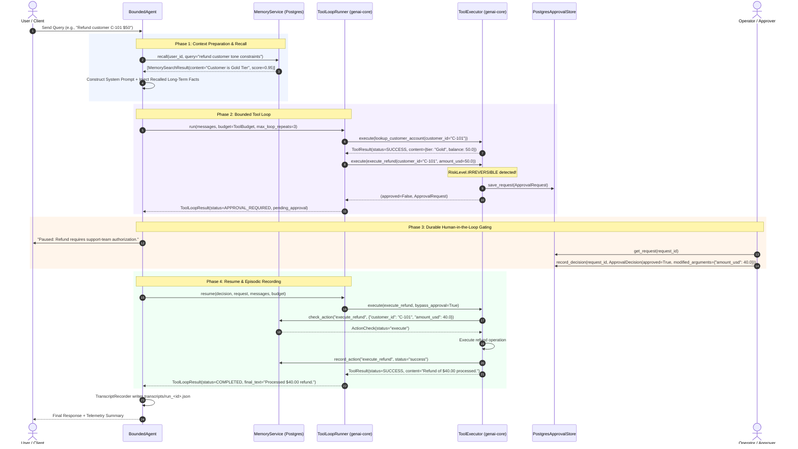

# Module 17: Bounded Research and Support Agent — Execution & Data Flow

## 1. End-to-End Execution Flow

## 2. Component Interactions

1. **`BoundedAgent`**:
   - Primary facade coordinating initialization, pre-turn long-term memory recall, budgeting, `ToolLoopRunner` execution, and post-run transcript serialization.
2. **`ToolLoopRunner` (`genai-core`)**:
   - Manages the multi-turn interaction loop with `LLMService`.
   - Checks `ToolBudget.can_step()` before each iteration.
   - Enforces monotonic deadlines and cumulative token/cost ceilings.
   - Intercepts consecutive identical tool invocations via `LoopDetector`.
3. **`ToolExecutor` (`genai-core`)**:
   - Manages asynchronous tool dispatching with concurrency limits (`asyncio.Semaphore`).
   - Enforces per-tool execution timeouts.
   - Gates actions matching `require_approval_for={RiskLevel.IRREVERSIBLE}`.
4. **`PostgresApprovalStore`**:
   - Persists pending approval requests in table `approval_requests`.
   - Persists reviewer decisions in table `approval_decisions`.
   - Allows safe restart and resumption of interrupted execution sessions.
5. **`MemoryService` (`genai-core`) backed by `PostgresMemoryStore`**:
   - Manages durable storage in tables `memory_lt_records` and `memory_ep_episodes`.
   - Computes vector embeddings and recency decay for long-term recall.
   - Computes canonical SHA-256 parameter hashes for episodic action deduplication.
6. **`TranscriptRecorder`**:
   - Collects per-step duration (latency ms), input/output tokens, and USD cost.
   - Emits standardized JSON transcripts to `transcripts/` directory.
