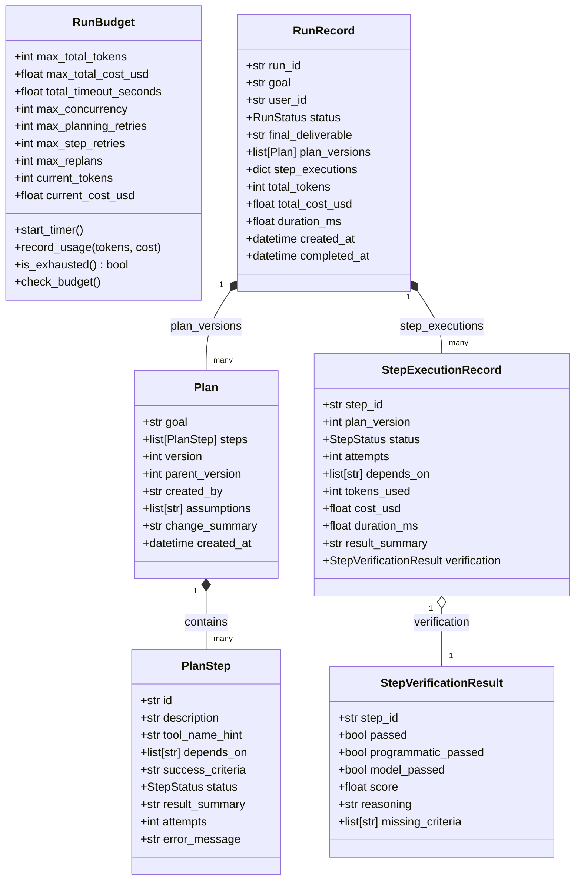

# Module 18: Plan-and-Execute Research Assistant — Execution & Data Flow

## 1. End-to-End System Execution Flow

```mermaid
sequenceDiagram
    autonumber
    actor User as User / Operator
    participant Assistant as PlanAndExecuteAssistant
    participant Mem as PlanningMemoryManager (genai_core)
    participant Planner as PlanGenerator
    participant Validator as PlanValidator
    participant Reviewer as HumanPlanReviewGateway
    participant Scheduler as DAGScheduler
    participant Executor as Module17StepExecutor (BoundedAgent)
    participant Verifier as StepVerifier (Programmatic + LLM)
    participant Replanner as ReplanningEngine
    participant Store as RunRecordStore

    User->>Assistant: Submit Goal (e.g., "Investigate customer C-101 and refund ticket T-101")
    
    rect rgb(240, 245, 255)
    Note over Assistant,Mem: Phase 1: Context & Memory Retrieval
    Assistant->>Mem: search_longterm(user_id, query=goal) [Preferences/Constraints]
    Assistant->>Mem: get_similar_past_plans(user_id, goal) [Past Plan Episodes]
    Mem-->>Assistant: Long-term preferences + similar past plan episodes
    end

    rect rgb(245, 240, 255)
    Note over Assistant,Validator: Phase 2: Plan Generation & DAG Validation
    Assistant->>Planner: generate_plan(goal, context, preferences, past_plans)
    Planner->>Planner: complete_structure(Plan) via LLMService
    Planner->>Validator: validate_plan(plan)
    alt Validation Fails (Cycle, missing dependency, duplicate IDs)
        Validator-->>Planner: PlanValidationError (Cycle trace / missing ID)
        Planner->>Planner: retry_with_critique(error, max_retries=3)
    end
    Validator-->>Assistant: Validated Plan v1 (DAG confirmed)
    Assistant->>Store: save_plan_version(run_id, v1, author="planner_llm")
    end

    rect rgb(255, 245, 235)
    Note over Assistant,Reviewer: Phase 3: Human Plan Review (Gating)
    Assistant->>Reviewer: request_review(Plan v1)
    Reviewer->>User: Present Plan v1 (steps, dependencies, criteria)
    alt Operator Modifies Plan
        User-->>Reviewer: submit_decision(MODIFY, modified_plan)
        Reviewer->>Validator: validate_plan(modified_plan)
        Reviewer->>Store: save_plan_version(run_id, v2, author="human_reviewer")
    else Operator Rejects Plan
        User-->>Reviewer: submit_decision(REJECT, reason="Unsafe strategy")
        Reviewer-->>Assistant: Abort run (RunStatus.CANCELLED)
    else Operator Approves Plan
        User-->>Reviewer: submit_decision(APPROVE)
    end
    end

    rect rgb(240, 255, 245)
    Note over Assistant,Scheduler: Phase 4: Concurrent DAG Scheduling & Step Execution
    Assistant->>Scheduler: execute_plan(approved_plan, budget=RunBudget)
    loop While Unfinished Steps Exist
        Scheduler->>Scheduler: resolve_ready_steps() [dependencies satisfied]
        par Concurrent Step Execution (Bounded by Semaphore)
            Scheduler->>Executor: execute_step(step_A, predecessor_context)
            Executor->>Executor: BoundedAgent.run(step_A)
            Executor-->>Scheduler: StepExecutionResult(status, text, tokens, cost)
            
            Scheduler->>Verifier: verify_step(step_A, result)
            Verifier->>Verifier: 1. Programmatic Checks (status, non-empty, format)
            Verifier->>Verifier: 2. Model-Based Judge (StepJudgeVerdict >= 0.85)
            Verifier-->>Scheduler: StepVerificationResult(passed=True/False, reasoning)
        end

        alt Step Verification Fails
            alt Step Attempts < max_step_retries
                Scheduler->>Scheduler: Retry step with verifier critique
            else Step Failed & Attempts Exhausted
                Scheduler->>Replanner: trigger_replan(plan, completed_steps, failed_step)
                Note over Replanner: Settle in-flight siblings; preserve all COMPLETED steps
                Replanner->>Validator: validate_plan(revised_plan)
                Replanner->>Store: save_plan_version(run_id, v_next, author="replanner")
                Replanner-->>Scheduler: Updated Plan (resumes on unfulfilled steps)
            end
        end
    end
    Scheduler-->>Assistant: All Steps Completed
    end

    rect rgb(245, 245, 255)
    Note over Assistant,Store: Phase 5: Synthesis & Persistence
    Assistant->>Assistant: Synthesize final verified deliverable
    Assistant->>Mem: record_episode(action_type="plan_execution", goal, plan_summary)
    Assistant->>Store: finalize_run_record(run_id, deliverable, total_tokens, total_cost)
    Assistant-->>User: Final Verified Deliverable + Execution Summary
    end
```

---

## 2. Structural DAG Validation Flow (Milestone 1 Implementation)


---

## 3. Core Domain Data Model Relationships


