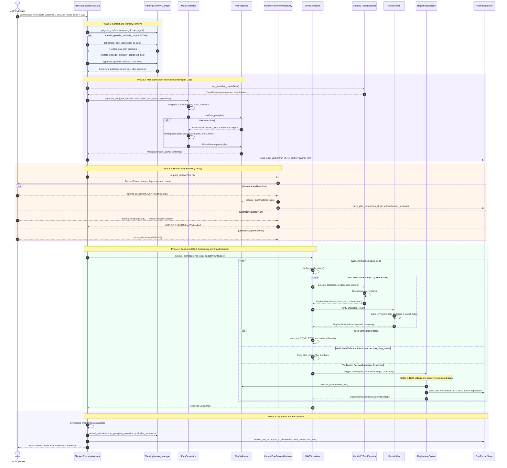
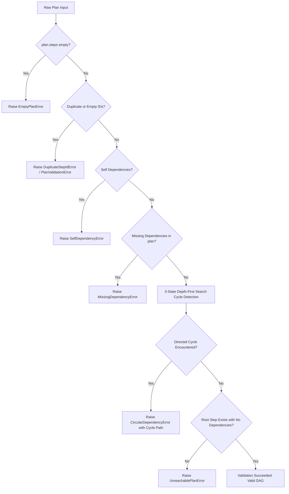
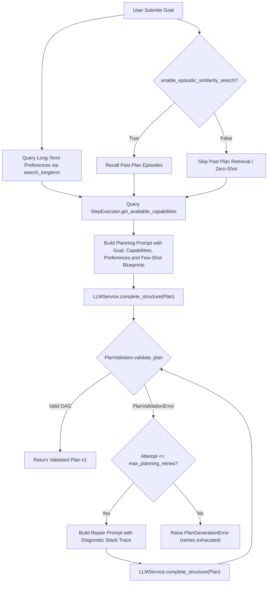
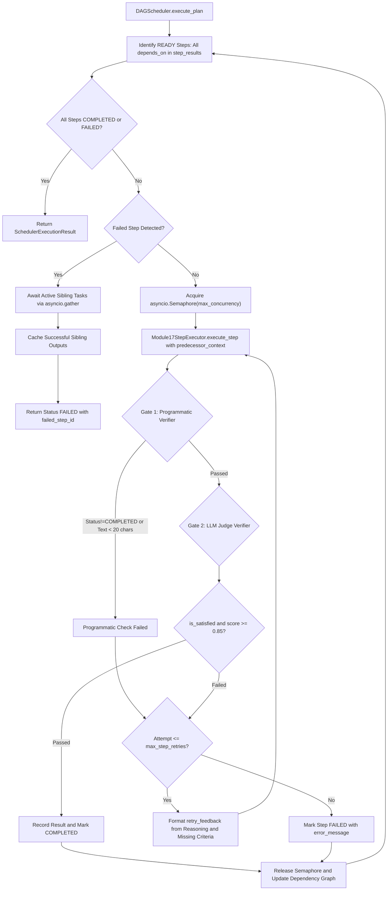
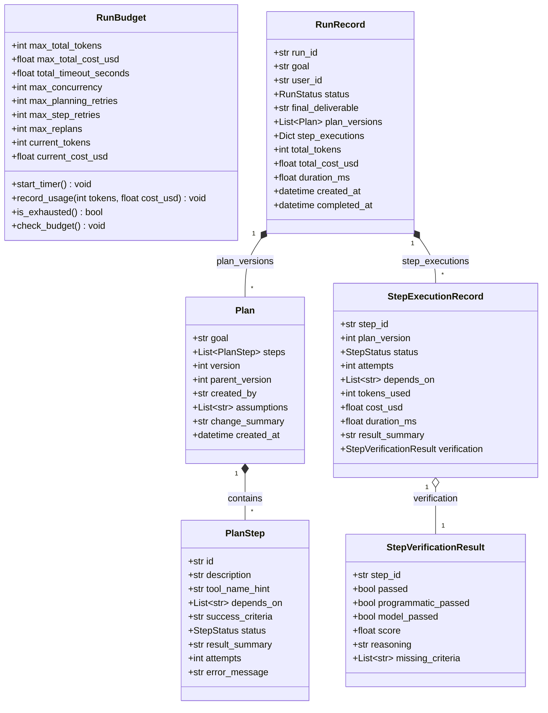

# Module 18: Plan-and-Execute Research Assistant — Execution & Data Flow

## 1. End-to-End System Execution Flow

---

## 2. Structural DAG Validation Flow (Milestone 1 Implementation)

---

## 3. Plan Generation, Automated Repair & Memory Integration Flow (Milestone 2 Implementation)

---

## 4. Async DAG Execution & Dual Verification Flow (Milestone 4 Implementation)

---

## 5. Core Domain Data Model Relationships

