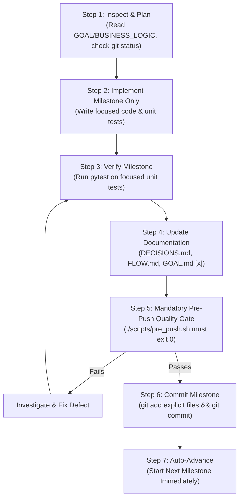

# Module 19: Self-Improving Report Writer — Development Workflow & Quality Gate Policy

This document establishes the permanent engineering, testing, documentation, and commit workflow rules for implementing Module 19.

---

## 1. Test Architecture & Structure

Module 19 strictly organizes automated tests into decoupled unit and integration suites:

```text
module-19-reflection/
├── src/
│   └── self_improving_report_writer/
│       ├── core/               # Configuration, budgets, exceptions
│       ├── models/             # Domain schemas (Report, Claim, Citation, etc.)
│       ├── retrieval/          # Source retrieval adapters
│       ├── generation/         # Structured report generator
│       ├── verification/       # Deterministic & semantic verifiers
│       ├── judging/            # Multi-dimensional rubric judge
│       ├── reflection/         # Critique engine, oscillation detector, orchestrator
│       ├── review/             # Acceptance gate & human review gateway
│       ├── memory/             # Episodic memory lesson manager
│       └── eval/               # Benchmark runner & metrics (Milestone 8)
│
├── tests/
│   ├── unit/                   # Fast, offline, isolated unit tests (0 network calls)
│   │   ├── models/             # Schema validation, uniqueness constraints
│   │   ├── retrieval/          # Retriever formatting & error handling
│   │   ├── generation/         # Generator prompt construction & parsing
│   │   ├── verification/       # Substring matching, citation reference checks
│   │   ├── judging/            # Rubric weight validation, score parsing
│   │   ├── reflection/         # Critique severities, oscillation detection
│   │   ├── review/             # Acceptance gates & review packet generation
│   │   └── memory/             # Lesson distillation & deduplication logic
│   │
│   ├── integration/            # Boundary tests against live/mocked services
│   │   ├── test_retrieval_integration.py   # genai-core RetrievalService interactions
│   │   ├── test_generation_integration.py  # LLMService complete_structure calls
│   │   ├── test_memory_integration.py      # EpisodicMemory persistence & lookup
│   │   └── test_report_pipeline.py         # End-to-end multi-round reflection flow
│   │
│   └── conftest.py             # Shared fixtures, mock providers, sample chunks
│
├── docs/                       # Project documentation
│   ├── GOAL.md                 # Project anchor (milestones & checkboxes)
│   ├── BUSINESS_LOGIC.md       # Authoritative business logic anchor
│   ├── DECISIONS.md            # Incremental architectural decision log
│   ├── DEVELOPMENT_WORKFLOW.md # Permanent workflow & quality rules (this file)
│   ├── FLOW.md                 # Implemented flow (created in M1; updated incrementally)
│   └── EVALUATION.md           # Benchmark plan (deferred to Milestone 8)
└── ...
```

---

## 2. Testing Rules for Every Milestone

1. **Test-Driven Progression:** Every milestone must introduce or update its relevant unit tests covering core logic, edge cases, invalid inputs, and failure scenarios.
2. **Domain Organization:** Tests must be organized by component/domain (e.g. `tests/unit/verification/`), not mechanically created one-for-one for every source file.
3. **No Live Credentials in Unit Tests:** Unit tests must execute offline, with zero external network dependencies, using mocks, fakes, or deterministic in-memory adapters.
4. **Integration Test Isolation:** Integration tests must be marked with `@pytest.mark.integration` and gated behind the repository's standard mechanism (`INTEGRATION_TEST=1` or equivalent marker configuration).
5. **Regression Protection:** When a new milestone touches or refactors existing behavior, add regression tests to ensure prior milestones remain 100% functional.
6. **Integrity Rule:** Never weaken, bypass, or delete assertions just to produce a passing result.
7. **No Deferred Testing:** Unit testing must **never** be postponed until the end of the project. Every milestone is only complete when its focused tests pass cleanly.

---

## 3. Documentation Lifecycle Rules

| Document | Authority Level | Permitted Actions During Implementation |
|---|---|---|
| `GOAL.md` | **Permanent Anchor** | Preserve requirements and milestone scopes. Only toggle milestone completion checkboxes (`[ ]` $\rightarrow$ `[x]`) upon successful commit. |
| `BUSINESS_LOGIC.md` | **Authoritative Reference** | Treat as source of truth. **Never edit without explicit operator permission.** If implementation reveals a contradiction, pause and report it. |
| `DECISIONS.md` | **Incremental Decision Log** | Append genuine architectural decisions made during implementation. Transition decisions from `Status: Proposed` to `Status: Implemented (Milestone X)` as milestones conclude. |
| `FLOW.md` | **Living Architecture Map** | Created during Milestone 1 from actual implemented code; updated incrementally after each completed milestone to reflect real system flows. |
| `EVALUATION.md` | **Deferred Specification** | **Do not create or maintain before Milestone 8.** Finalized collaboratively when Milestone 8 is reached. |
| `DEVELOPMENT_WORKFLOW.md` | **Operational Policy** | Permanent engineering, testing, pre-push, and commit protocol (this file). |

---

## 4. Mandatory Milestone Completion Sequence

For every milestone (Milestones 1 through 8), the following 7-step sequence is strictly mandatory:



### Detailed Sequence Steps:

#### Step 1 — Inspect and Plan
- Review target requirements in [GOAL.md](file:///home/harshilk/genai-engineer-journey/module-19-reflection/docs/GOAL.md) and [BUSINESS_LOGIC.md](file:///home/harshilk/genai-engineer-journey/module-19-reflection/docs/BUSINESS_LOGIC.md).
- Inspect existing Module 19 code and Git status (`git status`).
- Identify required source files, schemas, and unit test files.
- Ensure unrelated working tree changes (e.g. `exercise/hands_on/exercise.ipynb`) are strictly preserved.

#### Step 2 — Implement the Current Milestone Only
- Implement the milestone functionality within `src/self_improving_report_writer/`.
- Add comprehensive unit tests in `tests/unit/`.
- Do not implement premature features or jump ahead to future milestones.

#### Step 3 — Verify the Milestone
- Run focused pytest on the newly implemented tests:
  ```bash
  uv run pytest tests/unit/<target_domain>/ -v
  ```
- Fix any failures and run regression checks across all existing unit tests.

#### Step 4 — Update Documentation
- **`DECISIONS.md`:** Append or update decisions with `Status: Implemented (Milestone X)`.
- **`FLOW.md`:** On Milestone 1, create `FLOW.md` documenting actual implemented components. On subsequent milestones, update it to reflect newly wired interactions.
- **`GOAL.md`:** Mark the milestone checkbox complete (`- [x] Milestone X: ...`).
- **`BUSINESS_LOGIC.md`:** Do NOT touch without explicit permission.
- **`EVALUATION.md`:** Do NOT touch before Milestone 8.

#### Step 5 — Mandatory Pre-Push Quality Gate
Execute the repository's pre-push validation script:
```bash
./scripts/pre_push.sh
```
The script runs:
1. `ruff check .` (linting)
2. `ruff format --check .` (formatting)
3. `mypy .` (strict type-checking)
4. `pytest -v tests/` (full unit test suite)

If `pre_push.sh` fails:
1. Diagnose the exact root cause.
2. Fix implementation or tests.
3. Rerun focused tests, then rerun `./scripts/pre_push.sh`.
4. Repeat until it exits with code 0.
Never claim milestone success if this script has not passed.

#### Step 6 — Commit the Milestone
After `pre_push.sh` passes cleanly:
- Stage **only** the explicit files belonging to the completed milestone:
  ```bash
  git add src/self_improving_report_writer/<domain>/ tests/unit/<domain>/ docs/
  git commit -m "feat(module-19): implement <milestone objective>"
  ```
- **Rules:**
  - Never stage unrelated user files (e.g., `exercise.ipynb`).
  - Never amend previous milestone commits.
  - Never rewrite Git history.
  - Never skip a milestone commit.

#### Step 7 — Automatically Proceed to the Next Milestone
- Once the milestone commit is created, automatically proceed to Step 1 of the next milestone.
- Do not wait for separate user prompts between milestones unless a genuine technical blocker or ambiguous business rule requires human clarification.
- Provide a concise progress report at each milestone boundary:
  - Completed files and scope.
  - Tests run and results.
  - Pre-push validation outcome.
  - Commit hash.

---

## 5. Blocker and Error Handling Protocol

If an unexpected error, type conflict, or upstream dependency blocker arises:
1. **Never Falsify Completion:** Do not mark a milestone `[x]` or commit it as complete if tests or `pre_push.sh` fail.
2. **Transparent Reporting:** Report the blocker clearly:
   - What failed (error message, traceback).
   - What was attempted to resolve it.
   - The specific decision or clarification needed.
3. **Wait for Guidance:** Pause execution on that milestone until guidance is provided.
