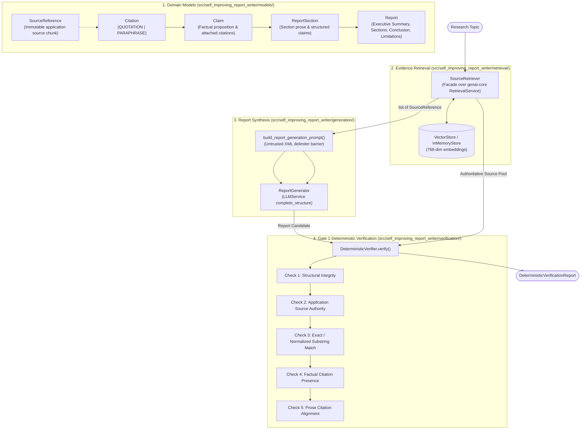
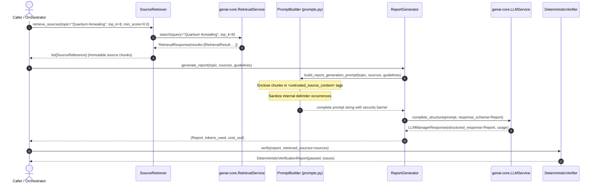
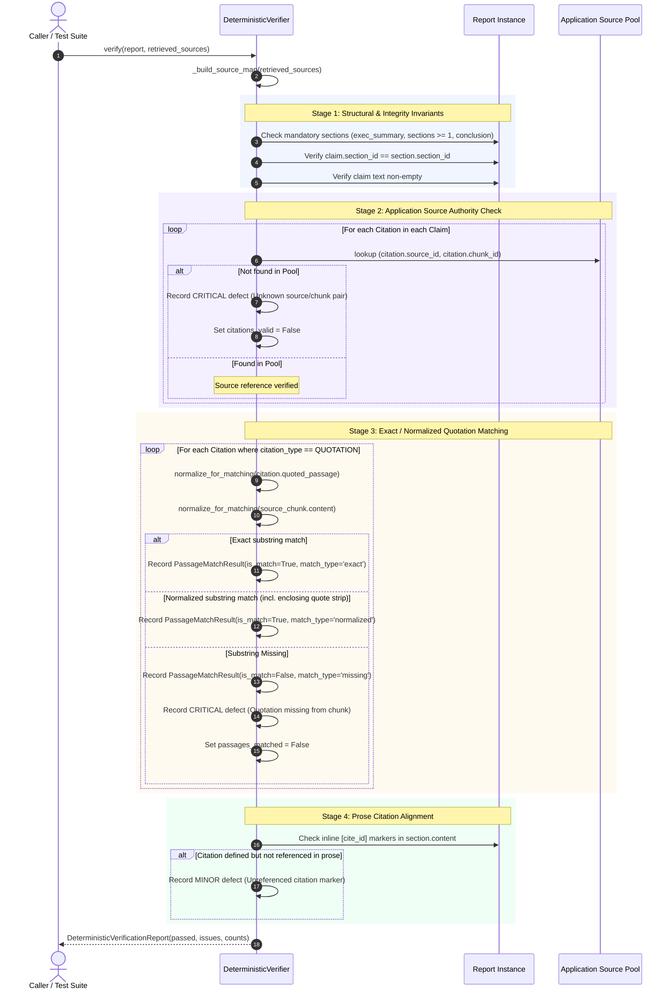

# Module 19: Self-Improving Report Writer — Implemented Execution & Data Flow

This document reflects the actual implemented execution and data flows in Module 19. It is created in Milestone 1 and updated incrementally after each completed milestone.

---

## 1. Implemented Architecture (Milestones 1 & 2)

---

## 2. Milestone 2: Evidence Retrieval & Synthesis Data Flow

---

## 3. Gate 1 Deterministic Verification Logic

