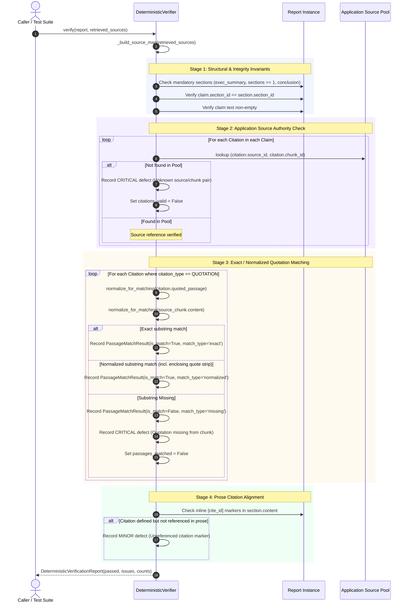

# Module 19: Self-Improving Report Writer — Implemented Execution & Data Flow

This document reflects the actual implemented execution and data flows in Module 19. It is created in Milestone 1 and updated incrementally after each completed milestone.

---

## 1. Milestone 1 Implemented Architecture

Milestone 1 establishes the core typed domain models and Gate 1 deterministic verification engine:

```mermaid
flowchart TD
    subgraph DataStructures["1. Domain Models (src/self_improving_report_writer/models/)"]
        SourceRef["SourceReference\n(Immutable application source chunk)"]
        CitationModel["Citation\n(QUOTATION | PARAPHRASE)"]
        ClaimModel["Claim\n(Factual proposition & attached citations)"]
        SectionModel["ReportSection\n(Section prose & structured claims)"]
        ReportModel["Report\n(Executive Summary, Sections, Conclusion, Limitations)"]

        SourceRef -.-> CitationModel
        CitationModel --> ClaimModel
        ClaimModel --> SectionModel
        SectionModel --> ReportModel
    end

    subgraph VerifierEngine["2. Gate 1 Deterministic Verification (src/self_improving_report_writer/verification/)"]
        InputReport(["Report Candidate"])
        SourcePool[("Application-Controlled\nSource Pool")]
        NormHelper["normalize_for_matching()\n(lowercase, whitespace collapse, quote normalization)"]
        Verifier["DeterministicVerifier.verify()"]

        CheckSchema["Check 1: Schema & Integrity Invariants\n(Unique section_ids, claim_ids, citation_ids)"]
        CheckAuthority["Check 2: Source Authority\n(Check source_id & chunk_id exist in pool)"]
        CheckQuotations["Check 3: Quotation Matching\n(Exact / Normalized Substring Containment)"]
        CheckClaims["Check 4: Factual Citation Presence\n(Factual claims must have citations)"]
        CheckProse["Check 5: Prose Reference Alignment\n(Inline [cite_id] markers in content)"]

        ReportOutput(["DeterministicVerificationReport\n(passed, issues, passage_matches)"])

        InputReport & SourcePool --> Verifier
        Verifier --> CheckSchema
        CheckSchema --> CheckAuthority
        CheckAuthority --> CheckQuotations
        CheckQuotations <--> NormHelper
        CheckQuotations --> CheckClaims
        CheckClaims --> CheckProse
        CheckProse --> ReportOutput
    end
```

---

## 2. Gate 1 Deterministic Verification Data Flow

