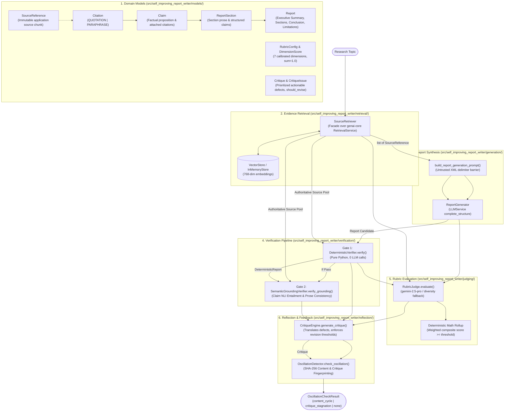
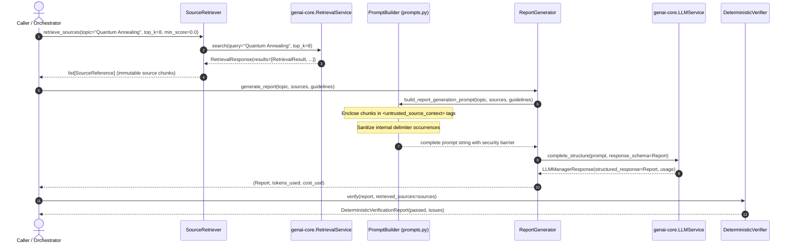
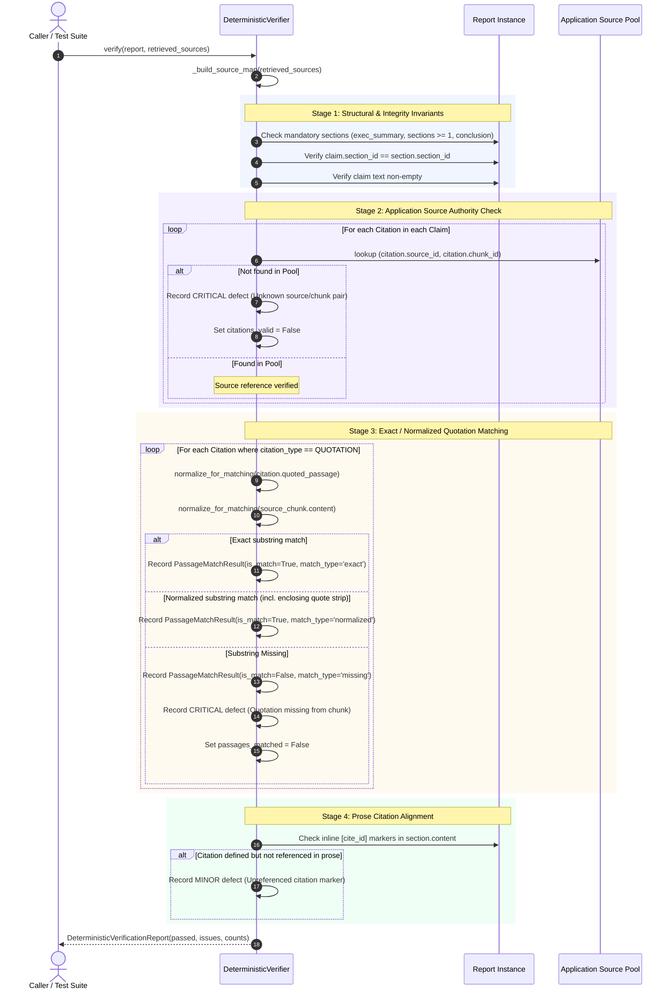
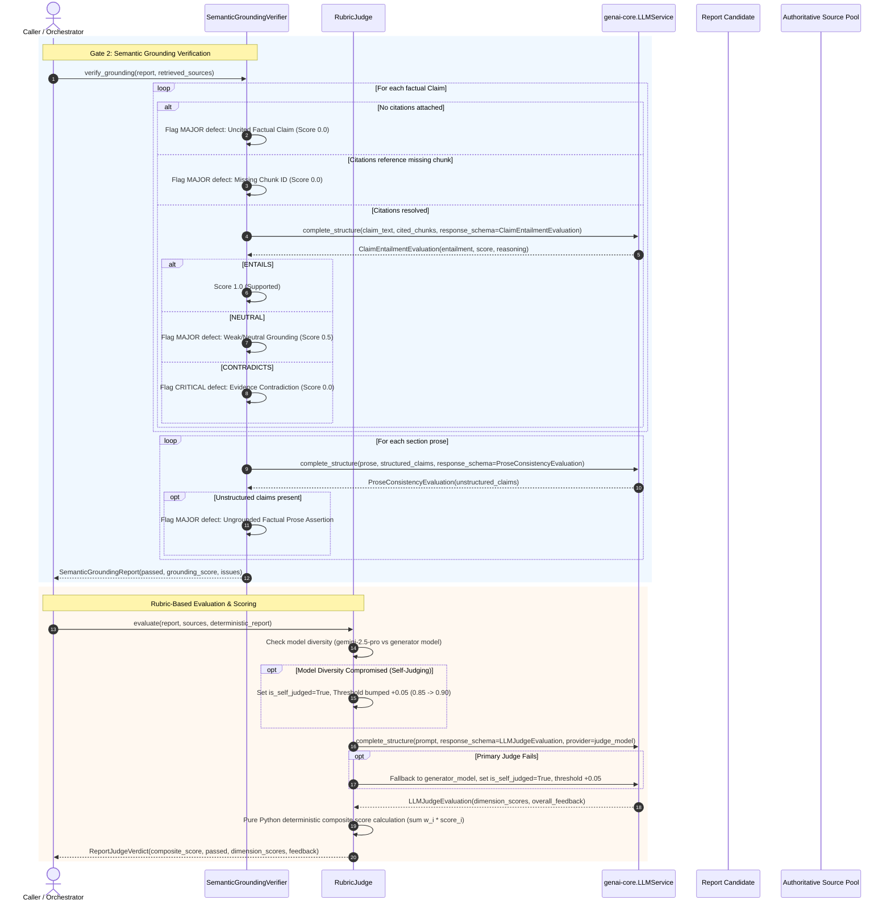
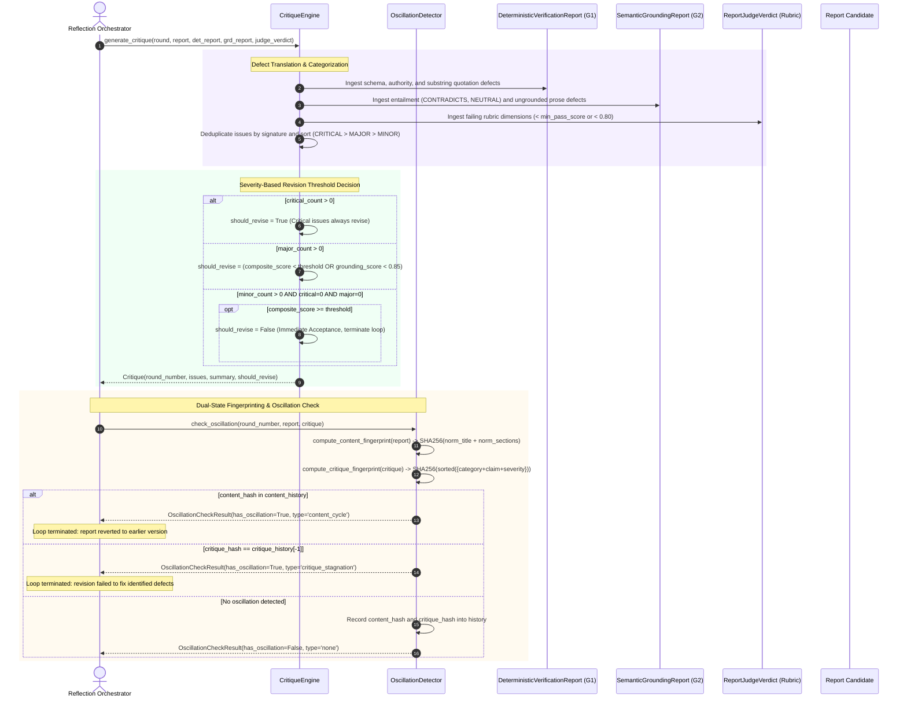
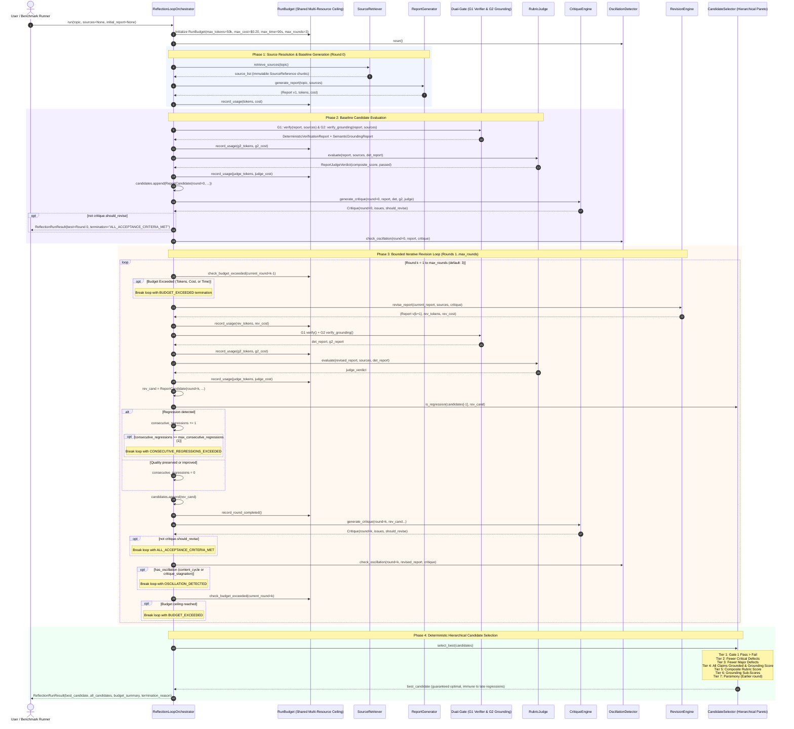
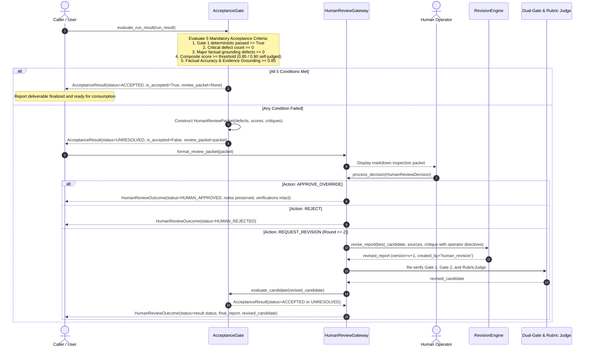
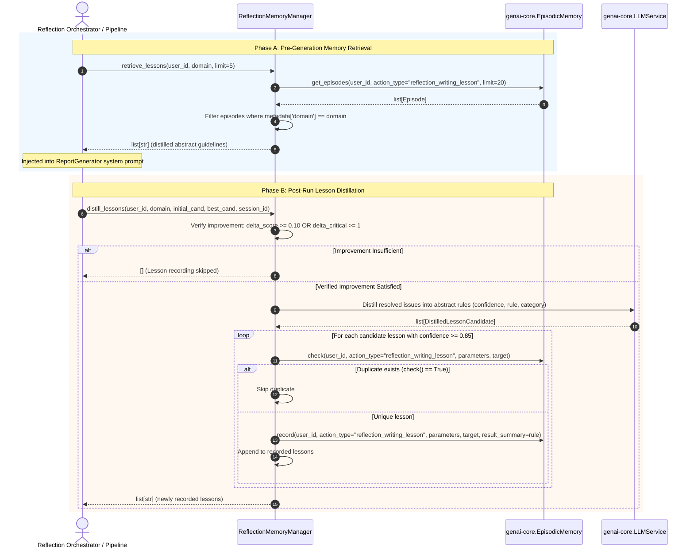
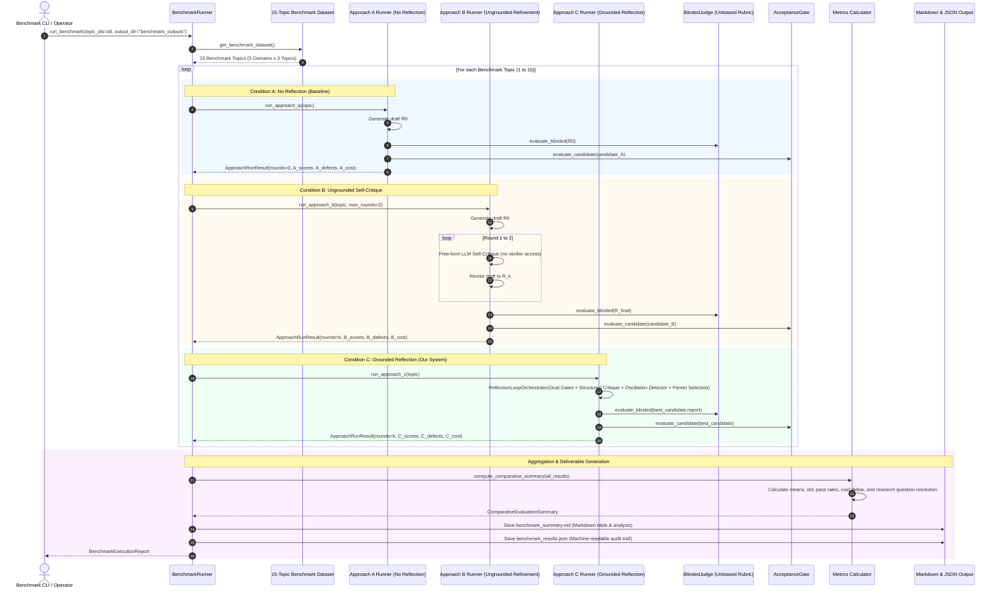

# Module 19: Self-Improving Report Writer — Implemented Execution & Data Flow

This document reflects the actual implemented execution and data flows in Module 19. It is created in Milestone 1 and updated incrementally after each completed milestone.

---

## 1. Implemented Architecture (Milestones 1, 2, 3 & 4)

---

## 2. Milestone 2: Evidence Retrieval & Synthesis Data Flow

---

## 3. Gate 1 Deterministic Verification Logic

---

## 4. Gate 2 Semantic Grounding & Rubric Judging Data Flow

---

## 5. Structured Critique Generation & Oscillation Detection Flow

---

## 6. Milestone 5: Bounded Reflection Orchestration & Candidate Selection Flow

---

## 7. Milestone 6: Acceptance Gate & Human Review Gateway Flow

---

## 8. Milestone 7: Episodic Memory Lesson Distillation & Retrieval Flow

---

## 9. Milestone 8: 15-Topic Comparative Benchmark Evaluation Flow

