# Module 19: Self-Improving Report Writer — Goals & Implementation Plan

## 1. Project Goal

Build a production-grade, bounded **Self-Improving Report Writer** that generates structured, cited reports from retrieved sources and iteratively improves their factual accuracy, grounding, completeness, and clarity through bounded, evidence-grounded reflection.

The central research question driving this module is:

> **Does grounded reflection improve report quality enough to justify its additional latency and cost?**

To answer this question conclusively, the system evaluates three distinct experimental conditions (**Approach A: No Reflection**, **Approach B: Ungrounded Self-Critique**, and **Approach C: Grounded Reflection**) across a controlled 15-topic benchmark suite with an independent, blinded judge.

---

## 2. Core Repository Integration & Boundary Analysis

### 2.1 Reused Architecture & Existing Packages

Module 19 strictly builds upon established foundation libraries in the repository:

1. **`packages/genai-core` Retrieval Capabilities:**
   - [RetrievalService](file:///home/harshilk/genai-engineer-journey/packages/genai-core/src/genai_core/services/retrieval_service.py): Orchestrates hybrid vector and keyword search, candidate pooling, and cross-encoder re-ranking.
   - [DocumentChunk](file:///home/harshilk/genai-engineer-journey/packages/genai-core/src/genai_core/models/retrieval_model/document_chunk.py) and [RetrievalResult](file:///home/harshilk/genai-engineer-journey/packages/genai-core/src/genai_core/models/retrieval_model/retrieval_response.py): Provide immutable source text, unique chunk IDs, and relevance metadata for citation binding.
   - [InMemoryVectorStore](file:///home/harshilk/genai-engineer-journey/packages/genai-core/src/genai_core/retrieval/in_memory_store.py) and [PGVectorStoreAdapter](file:///home/harshilk/genai-engineer-journey/packages/genai-core/src/genai_core/retrieval/pgvector_store.py): Provide fast local testing and scalable persistent vector indexing.

2. **`packages/genai-core` LLM & Evaluation Capabilities:**
   - [LLMService](file:///home/harshilk/genai-engineer-journey/packages/genai-core/src/genai_core/services/llm_services.py): Provider-independent structured output generation (`complete_structure`) across Google, OpenAI, and Anthropic backends.
   - [FaithfulnessEvaluator](file:///home/harshilk/genai-engineer-journey/packages/genai-core/src/genai_core/evaluation/evaluators/faithfulness.py): Hallucination and claim-grounding detection using structured [JudgeVerdict](file:///home/harshilk/genai-engineer-journey/packages/genai-core/src/genai_core/models/evaluation_model/judge_verdict.py).
   - [safe_log](file:///home/harshilk/genai-engineer-journey/packages/genai-core/src/genai_core/observability/logger.py) and [ObservabilityEvent](file:///home/harshilk/genai-engineer-journey/packages/genai-core/src/genai_core/observability/events.py): Enterprise audit logging and telemetry without leaking sensitive credentials or PII.

3. **`packages/genai-core` Memory Infrastructure:**
   - [EpisodicMemory](file:///home/harshilk/genai-engineer-journey/packages/genai-core/src/genai_core/memory/episodic.py): Reused for post-run reflection lesson recording via canonical parameter hashing (`canonical_fingerprint`) and idempotency checks (`check`).

### 2.2 Integration with Module 17 & Module 18

- **Module 18 Reflection Extension Point ([PlanReflector](file:///home/harshilk/genai-engineer-journey/module-18-planning/src/plan_and_execute_research_assistant/protocols/reflector.py)):**
  - *Inspection Finding:* Module 18 defines `PlanReflector` taking a DAG `Plan` and `StepExecutionRecord`s to output a `should_replan` boolean and plan improvements.
  - *Architectural Decision:* Module 19 defines a dedicated, domain-specific `ReportReflector` protocol optimized for claims, citations, verifier outputs, and multi-dimensional rubrics. Coupling report reflection to DAG replanning abstractions would violate the Single Responsibility Principle. For backwards compatibility and future integration, an adapter (`PlanToReportReflectorAdapter`) is designed to allow Module 18 planners to delegate synthesis steps to Module 19.
- **Module 17 Agent Patterns:**
  - Adopts Module 17's bounded execution and budget-envelope philosophy (`RunBudget`) to guarantee deterministic halting across all LLM reflection calls.

---

## 3. Functional Requirements (FR)

- **FR-1: Source Retrieval & Ingestion:** Ingest research topics, retrieve relevant context using `RetrievalService`, and preserve source chunk identities (`source_id`, `chunk_id`, raw text) for downstream verification.
- **FR-2: Structured Report Generation:** Synthesize a validated report conforming to a typed schema with sections, factual claims, and claim-level citations linked to retrieved chunks.
- **FR-3: Dual-Gate Verification:**
  - *Gate 1 (Deterministic):* Pydantic schema validation, mandatory section checks, citation pointer validity, and exact/normalized substring verification of quoted passages against retrieved source chunks.
  - *Gate 2 (Semantic Grounding):* Claim-passage entailment verification using an LLM evaluator to confirm that cited passages actually support the semantic assertions made in the claim.
- **FR-4: Multi-Dimensional Rubric Judging:** Evaluate report candidates across 7 weighted dimensions (Factual Accuracy, Evidence Grounding, Citation Correctness, Completeness, Relevance, Clarity, and Logical Consistency) with strict mathematical calibration (weights sum to 1.0) and model diversity.
- **FR-5: Structured Critique Generation:** Generate actionable critiques classified into `CRITICAL`, `MAJOR`, and `MINOR` severity tiers, specifying the affected claim, source reference, and concrete suggested correction.
- **FR-6: Bounded Reflection & Revision Loop:** Execute a configurable revision cycle (default: max 3 rounds) updating the report against identified critiques, while strictly halting if budgets (tokens, cost, wall-clock time) expire.
- **FR-7: Oscillation & Regression Prevention:** Hash report and critique states across rounds to detect circular revisions or regressions, terminating the loop immediately if oscillation occurs.
- **FR-8: Best-So-Far Candidate Selection:** Preserve all revision iterations and select the optimal candidate using a multi-factor Pareto ranking (deterministic pass -> zero critical defects -> composite rubric score), preventing late-round regressions from degrading the output.
- **FR-9: Honest Acceptance & Human Review Gateway:** Transition reports to explicit terminal states (`ACCEPTED` or `UNRESOLVED`). Reports with unresolved critical issues or sub-threshold scores are never falsely accepted, and unresolved reports generate structured human review packets.
- **FR-10: Distilled Episodic Memory Lessons:** Distill high-confidence (>= 0.85) lessons from completed runs and persist them via `EpisodicMemory.record`, utilizing canonical parameter hashing to eliminate duplicate lessons.

---

## 4. Non-Functional Requirements (NFR)

- **NFR-1: Bounded Cost and Latency:** The system must enforce a global budget envelope (default: $0.20 USD, 50,000 tokens, 90 seconds timeout per run).
- **NFR-2: Model Diversity & Fallback Transparency:** The judge model must differ from the generator model (e.g., Gemini 2.5 Pro vs Gemini 3.5 Flash-Lite). When provider constraints force using the same model, the system must set `is_self_judged=True` and log an audit warning.
- **NFR-3: Untrusted Content Defense:** Retrieved source content must be treated as untrusted data. Prompts must strictly isolate source passages to prevent prompt-injection attacks from overriding reporting or reflection instructions.
- **NFR-4: Type Safety & Code Quality:** 100% type-annotated Python conforming to `mypy --strict`, with 0 ruff errors, and full test isolation.
- **NFR-5: Reproducibility:** Fixed seeds and temperature controls (temperature = 0.0 for verifiers and judges; temperature = 0.2 for report generation) to minimize variance.
- **NFR-6: Comprehensive Observability:** Every retrieval, generation, verification, critique, revision, and memory interaction must emit structured `safe_log` events with execution metadata.

---

## 5. Scope & Ordered Implementation Milestones

```mermaid
gantt
    title Module 19 Implementation Progression
    dateFormat  X
    axisFormat %d
    section Foundation
    M1 Domain Models & Deterministic Verifier   :active, 0, 1
    M2 Source Retrieval & Baseline Generator   :1, 2
    section Evaluation & Reflection
    M3 Semantic Grounding & Rubric Judge       :2, 3
    M4 Structured Critiques & Oscillation      :3, 4
    M5 Bounded Loop & Best-So-Far Selection    :4, 5
    section Governance & Integration
    M6 Acceptance Gate & Human Review Gateway  :5, 6
    M7 Episodic Memory Lesson Distillation     :6, 7
    section Benchmark & Verification
    M8 15-Topic Comparative Evaluation Suite   :7, 8
```

### [x] Milestone 1: Domain Models, Report Schema & Deterministic Verifier
- **Objective:** Establish typed data structures and fast deterministic verification routines.
- **Scope:**
  - Define `Report`, `ReportSection`, `Claim`, `Citation`, `SourceReference`.
  - Define `VerificationResult`, `PassageMatchResult`, `DeterministicVerificationReport`.
  - Implement `DeterministicVerifier` checking required fields, citation validity, and normalized substring matching of quoted passages against retrieved source chunks.
- **Key Files:**
  - `src/self_improving_report_writer/models/report.py`
  - `src/self_improving_report_writer/models/verification.py`
  - `src/self_improving_report_writer/verification/deterministic_verifier.py`
- **Tests Required:** `tests/unit/test_report_schema.py`, `tests/unit/test_deterministic_verifier.py`.
- **Acceptance Criteria:** Deterministic verifier catches missing fields, fabricated citation IDs, and missing substring passages with 100% accuracy in unit tests.

### [ ] Milestone 2: Source Retrieval Integration & Baseline Generator
- **Objective:** Ingest topics, query `genai-core.RetrievalService`, and generate structured baseline reports.
- **Scope:**
  - Implement `SourceRetriever` wrapping `RetrievalService` with fallback to `InMemoryVectorStore`.
  - Implement `ReportGenerator` invoking `LLMService.complete_structure` with typed `Report` schema.
  - Implement prompt isolation preventing prompt injections in retrieved chunks.
- **Key Files:**
  - `src/self_improving_report_writer/retrieval/source_retriever.py`
  - `src/self_improving_report_writer/generation/report_generator.py`
  - `src/self_improving_report_writer/generation/prompts.py`
- **Tests Required:** `tests/unit/test_source_retriever.py`, `tests/unit/test_report_generator.py`.
- **Acceptance Criteria:** Generates well-formed reports matching `Report` schema with valid citation IDs corresponding to retrieved chunks.

### [ ] Milestone 3: Semantic Grounding Verifier & Rubric-Based Judge
- **Objective:** Implement semantic entailment verification and multi-dimensional rubric judging.
- **Scope:**
  - Implement `SemanticGroundingVerifier` evaluating claim-passage entailment via LLM.
  - Implement `RubricJudge` evaluating reports across 7 weighted dimensions.
  - Implement rubric configuration validator (weights sum to 1.0, valid threshold ranges).
  - Implement model diversity configuration with fallback self-judging disclosure (`is_self_judged=True`).
- **Key Files:**
  - `src/self_improving_report_writer/models/rubric.py`
  - `src/self_improving_report_writer/verification/semantic_grounding_verifier.py`
  - `src/self_improving_report_writer/judging/rubric_judge.py`
  - `src/self_improving_report_writer/judging/prompts.py`
- **Tests Required:** `tests/unit/test_rubric_validator.py`, `tests/unit/test_rubric_judge.py`, `tests/unit/test_grounding_verifier.py`.
- **Acceptance Criteria:** Validates rubric configs; correctly identifies supported vs unsupported claims; outputs calibrated composite scores.

### [ ] Milestone 4: Structured Critique Engine & Oscillation Detection
- **Objective:** Translate verification failures and rubric deficits into structured critiques, and detect revision cycles.
- **Scope:**
  - Define `Critique`, `CritiqueIssue`, `IssueSeverity` (`CRITICAL`, `MAJOR`, `MINOR`), and `IssueCategory`.
  - Implement `CritiqueEngine` aggregating deterministic failures, grounding defects, and rubric feedback.
  - Implement `OscillationDetector` tracking SHA-256 fingerprints of report content and critique issue sets to detect cyclical regressions.
- **Key Files:**
  - `src/self_improving_report_writer/models/critique.py`
  - `src/self_improving_report_writer/reflection/critique_engine.py`
  - `src/self_improving_report_writer/reflection/oscillation_detector.py`
- **Tests Required:** `tests/unit/test_critique_engine.py`, `tests/unit/test_oscillation_detector.py`.
- **Acceptance Criteria:** Correctly tags severity levels; detects cycles when an identical or previously seen report version re-appears.

### [ ] Milestone 5: Bounded Reflection Orchestrator & Best-So-Far Selection
- **Objective:** Coordinate the iterative reflection-revision loop with multi-resource budget enforcement.
- **Scope:**
  - Implement `RevisionEngine` taking current report, retrieved sources, and filtered critiques to produce revised `Report`.
  - Implement `CandidateSelector` ranking all candidates using multi-factor hierarchical comparison (Verifier Pass > Critical Issue Count > Major Issue Count > Composite Score).
  - Implement `ReflectionLoopOrchestrator` enforcing max rounds (3), token budget, cost cap, and wall-clock deadline.
- **Key Files:**
  - `src/self_improving_report_writer/reflection/revision_engine.py`
  - `src/self_improving_report_writer/reflection/candidate_selector.py`
  - `src/self_improving_report_writer/reflection/orchestrator.py`
  - `src/self_improving_report_writer/core/budget.py`
- **Tests Required:** `tests/unit/test_revision_engine.py`, `tests/unit/test_candidate_selector.py`, `tests/unit/test_reflection_orchestrator.py`.
- **Acceptance Criteria:** Terminates gracefully upon budget exhaustion, returns the best-so-far candidate even if late rounds regress, and respects max round limits.

### [ ] Milestone 6: Honest Acceptance Gate & Human Review Gateway
- **Objective:** Enforce honest terminal outcomes and provide operator review workflows.
- **Scope:**
  - Implement `AcceptanceGate` evaluating best candidate against deterministic criteria and score thresholds.
  - Implement explicit states: `ACCEPTED` and `UNRESOLVED`.
  - Implement `HumanReviewGateway` generating structured inspection packets and handling operator actions (`APPROVE_OVERRIDE`, `REQUEST_REVISION`, `REJECT`).
- **Key Files:**
  - `src/self_improving_report_writer/models/outcome.py`
  - `src/self_improving_report_writer/review/acceptance_gate.py`
  - `src/self_improving_report_writer/review/human_review_gateway.py`
- **Tests Required:** `tests/unit/test_acceptance_gate.py`, `tests/unit/test_human_review_gateway.py`.
- **Acceptance Criteria:** Never marks a report `ACCEPTED` if critical defects remain or score < 0.85; correctly structures human review packets.

### [ ] Milestone 7: Episodic Memory Lesson Distillation
- **Objective:** Persist validated reflection lessons to `genai-core.EpisodicMemory`.
- **Scope:**
  - Implement `ReflectionMemoryManager` interacting with `EpisodicMemory.record` and `EpisodicMemory.check`.
  - Implement confidence filtering: only distill lessons with confidence >= 0.85 from completed runs that demonstrated verified improvement.
  - Use canonical parameter hashing to ensure idempotent deduplication.
  - Implement retrieval of applicable past lessons for injection into new report runs.
  - Soft failure handling: memory exceptions log warnings without crashing report generation.
- **Key Files:**
  - `src/self_improving_report_writer/memory/reflection_memory_manager.py`
- **Tests Required:** `tests/unit/test_reflection_memory_manager.py`.
- **Acceptance Criteria:** Persists distilled lessons to episodic memory; skips duplicates; filters low-confidence entries; retrieves past lessons safely.

### [ ] Milestone 8: 15-Topic Comparative Evaluation Suite & Benchmark Runner
- **Objective:** Execute the controlled 15-topic evaluation comparing Approaches A, B, and C.
- **Scope:**
  - Curate 15 diverse benchmark research topics across 5 domains with gold retrieval corpora.
  - Implement runners for Approach A (No Reflection), Approach B (Ungrounded Self-Critique), and Approach C (Grounded Reflection).
  - Implement independent blinded judge evaluating anonymized outputs.
  - Compute comparative metrics (Quality, Citation Accuracy, Latency, Cost, Acceptance Rate).
  - Output tabular and markdown evaluation reports.
- **Key Files:**
  - `src/self_improving_report_writer/eval/dataset.py`
  - `src/self_improving_report_writer/eval/runners.py`
  - `src/self_improving_report_writer/eval/metrics.py`
  - `src/self_improving_report_writer/eval/benchmark_runner.py`
  - `scripts/run_eval.py`
- **Tests Required:** `tests/integration/test_benchmark_pipeline.py`.
- **Acceptance Criteria:** Successfully executes 15 topics across all 3 conditions; outputs comparative metrics resolving the central research question.

---

## 6. Deliverables & Acceptance Criteria Summary

| Deliverable | Location | Target Acceptance Standard |
|---|---|---|
| Domain Models | `src/self_improving_report_writer/models/` | 100% Pydantic v2 schemas with field-level validators |
| Verification Engine | `src/self_improving_report_writer/verification/` | Dual-gate: deterministic string checks + semantic entailment |
| Rubric Judge | `src/self_improving_report_writer/judging/` | 7 calibrated dimensions, model diversity, fallback self-judging disclosure |
| Reflection Engine | `src/self_improving_report_writer/reflection/` | Bounded execution, oscillation detection, best-so-far Pareto selection |
| Human Review & Acceptance | `src/self_improving_report_writer/review/` | Explicit `ACCEPTED` / `UNRESOLVED` states, review packet generation |
| Episodic Memory Manager | `src/self_improving_report_writer/memory/` | Reuses `genai-core.EpisodicMemory`, confidence filtering (>= 0.85), deduplication |
| 15-Topic Benchmark Suite | `src/self_improving_report_writer/eval/` | 15 topics, 3 conditions, blinded judge, complete metric calculation |
| Pre-Push Quality Standard | `scripts/pre_push.sh` | Ruff check clean, Ruff format clean, Mypy strict clean, 100% unit tests passing |
