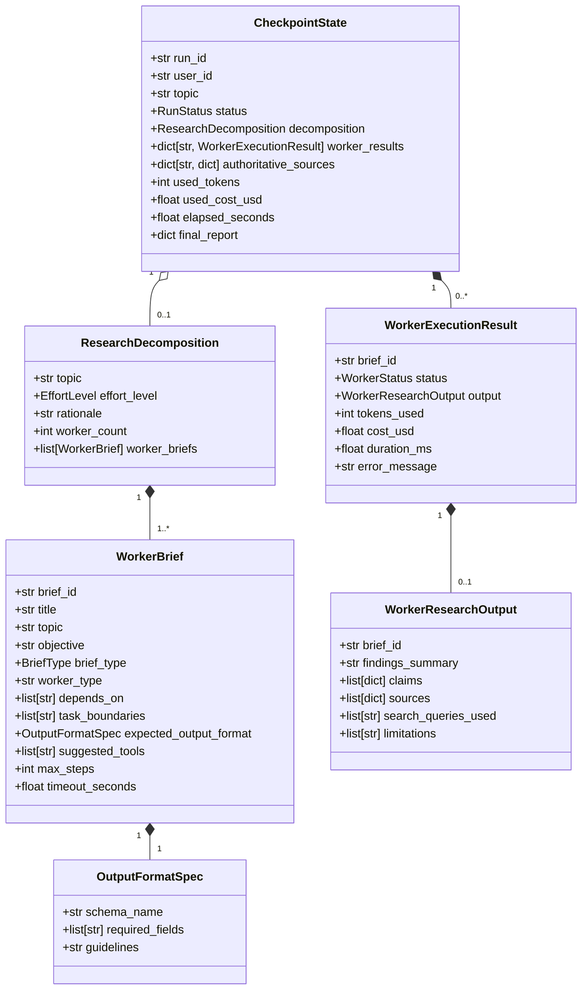
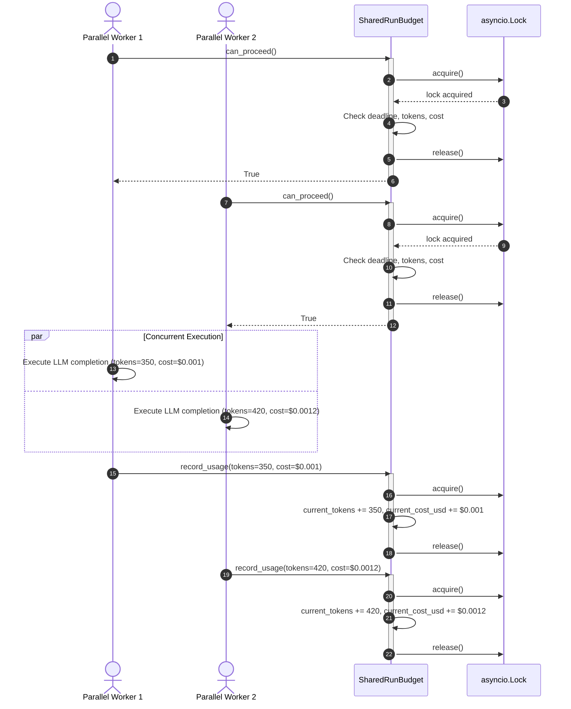
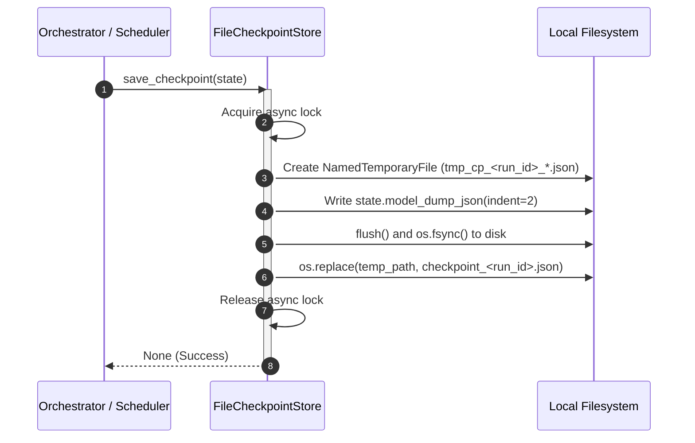
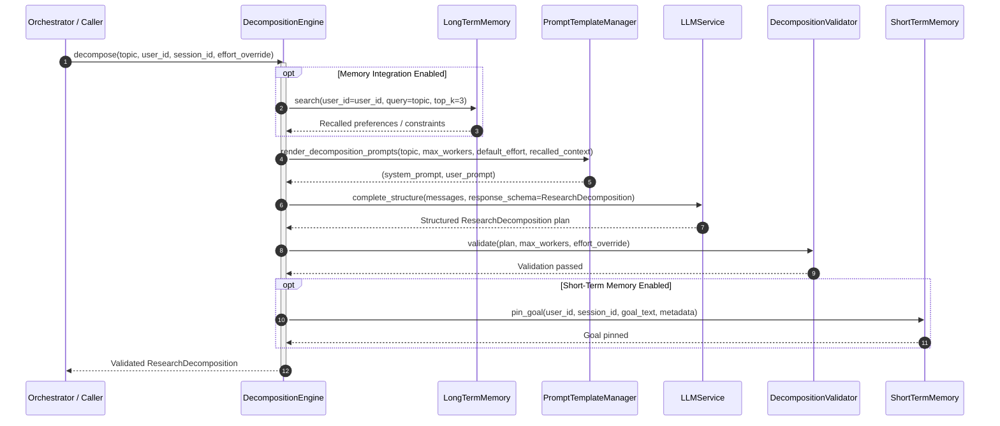
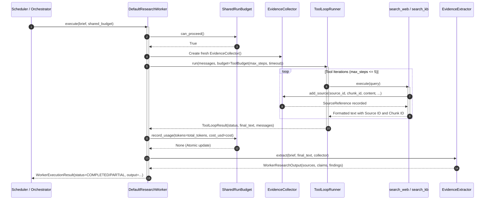
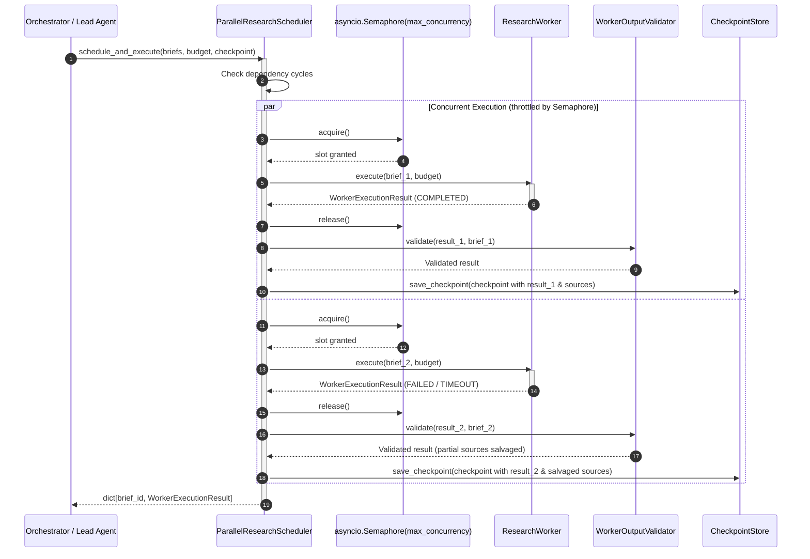

# Module 20: Parallel Research Team — Execution & Data Flow

This document details how data and control flow through the implemented components of Module 20. It reflects the concrete implementation as built.

---

## 1. Domain Model Hierarchy & Relationships

---

## 2. Shared Budget Concurrency Flow

The `SharedRunBudget` coordinates concurrent worker tasks and prevents race conditions using an `asyncio.Lock`:

---

## 3. Atomic Checkpoint Persistence Flow

`FileCheckpointStore` guarantees crash consistency by writing snapshots to a temporary file before atomically replacing the destination:

---

## 4. Lead Agent Decomposition Flow

The `DecompositionEngine` orchestrates memory recall, prompt rendering, structured LLM generation, validation, and goal pinning:

---

## 5. Bounded Research Worker Execution & Evidence Collection Flow

`DefaultResearchWorker` wraps `ToolLoopRunner`, collects evidence deterministically, deducts shared budget atomically, and isolates all failures:

---

## 6. Parallel Scheduling, Concurrency Control & Real-Time Checkpointing Flow

`ParallelResearchScheduler` orchestrates concurrent worker execution through `asyncio.Semaphore`, isolates sibling failures with `asyncio.gather(..., return_exceptions=True)`, validates deliverables, and persists state incrementally:

