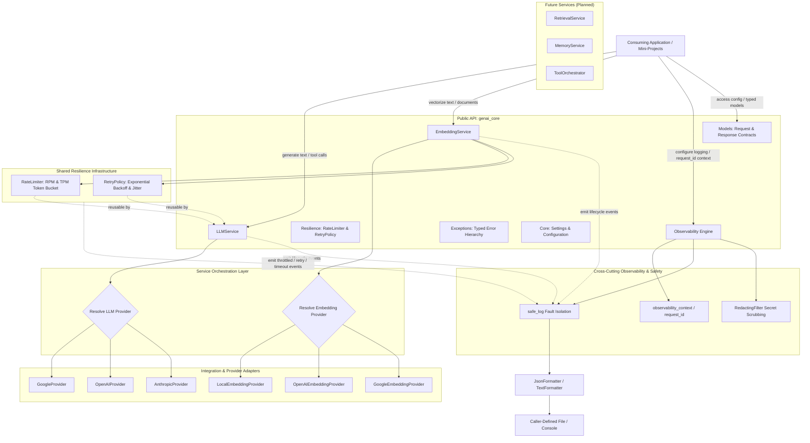
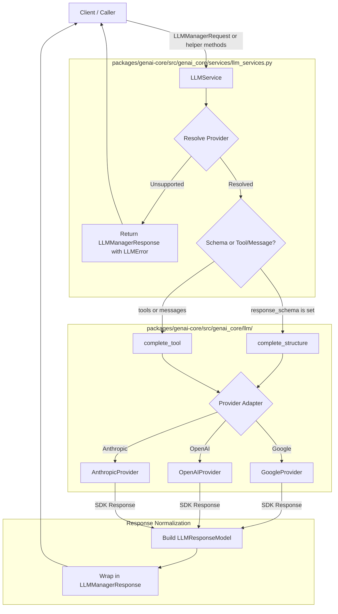
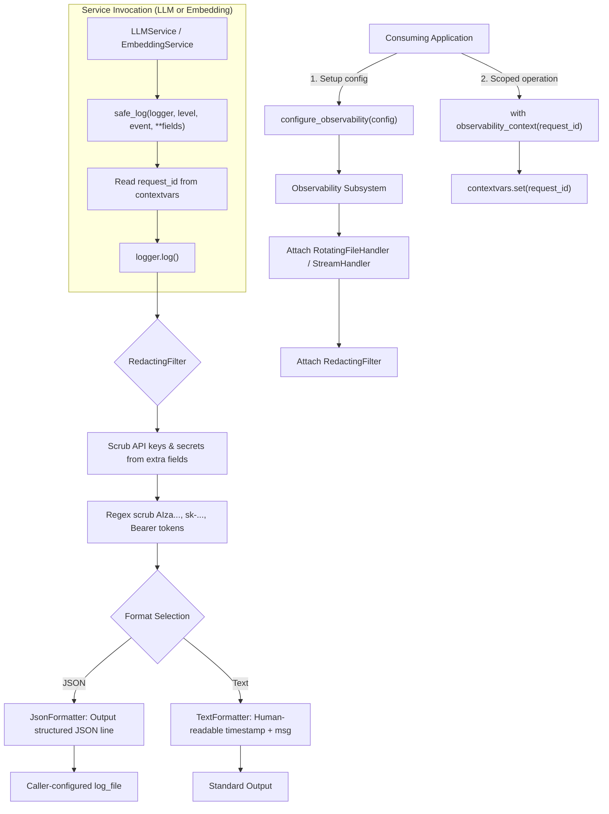

# Execution & Data Flow: `genai-core` Scope

This document details the actual verified execution flows, component interactions, and data normalization across the entire `genai-core` package (`packages/genai-core/`).

It is structured by service and capability, providing an evolving architecture map of how components connect.

---

## 1. Overall Package Architecture & Component Interconnection

`genai-core` provides reusable, provider-agnostic GenAI capabilities designed with clean layer separation, loose coupling, shared resilience, and cross-cutting observability:



### Component Roles & Responsibilities:
- **`genai_core.services`**: Unified entry points (`LLMService`, `EmbeddingService`). Validate input, resolve providers, coordinate internal batching, manage fault isolation, and emit observability events.
- **`genai_core.resilience`**: Shared asynchronous resilience infrastructure (`RateLimiter`, `AsyncTokenBucket`, `RetryPolicy`, `execute_with_retry`, `extract_retry_after`, `estimate_tokens`). Implements in-memory token bucket pacing for RPM/TPM and bounded retries with jitter and deadlines. Designed as a package-level capability reusable across embeddings, LLMs, and future services.
- **`genai_core.llm`**: Adapters conforming to `LLMProvider` protocol translating between normalized contracts and vendor SDKs (Google, OpenAI, Anthropic).
- **`genai_core.embedding`**: Adapters conforming to `EmbeddingProvider` protocol:
  - `LocalEmbeddingProvider`: CPU-bound models (`sentence-transformers`) non-blocking in background threads.
  - `OpenAIEmbeddingProvider`: Hosted OpenAI models (`text-embedding-3-small`, `text-embedding-3-large`, `text-embedding-ada-002`) with flexible output dimensions and exact usage reporting.
  - `GoogleEmbeddingProvider`: Hosted Google Gemini models (`text-embedding-005`) with `output_dimensionality` truncation and error wrapping.
- **`genai_core.observability`**: Reusable logging with caller-isolated outputs, secret/key scrubbing, asynchronous request context propagation, and zero side effects by default.
- **`genai_core.models`**: Pydantic v2 schemas (`ChatMessage`, `LLMManagerRequest`, `LLMResponseModel`, `EmbeddingRequest`, `EmbeddingResponse`, `ToolSpec`).
- **`genai_core.exceptions`**: Typed error hierarchies (`LLMError`, `EmbeddingError`, `EmbeddingDimensionError`, `EmbeddingTimeoutError`, `EmbeddingRateLimitError`, `MissingExtraDependencyError`, `EmbeddingProviderError`).
- **`genai_core.core`**: Environment settings loaded via `pydantic-settings` with explicit precedence and fallback defaults.

---

## 2. LLMService Execution Flow

The diagram below illustrates how client calls enter `LLMService`, get dispatched to provider adapters conforming to `LLMProvider`, and return normalized responses:



### 2.1 Request Dispatch & Routing
- **File**: [`packages/genai-core/src/genai_core/services/llm_services.py`](file:///home/harshilk/genai-engineer-journey/packages/genai-core/src/genai_core/services/llm_services.py)
- **Function**: [`LLMService.complete`](file:///home/harshilk/genai-engineer-journey/packages/genai-core/src/genai_core/services/llm_services.py#L55-L121)
- **Execution Flow**:
  1. Receives an [`LLMManagerRequest`](file:///home/harshilk/genai-engineer-journey/packages/genai-core/src/genai_core/models/llm_model/llm_manager_request.py).
  2. Resolves provider name via precedence: `request.provider` -> `self.default_provider` -> `settings.default_llm_provider` -> fallback `"google"`.
  3. Checks `self.providers.get(provider_name)`.
  4. If provider is `None`: immediately returns `LLMManagerResponse(error=LLMError(provider=provider_name, code="unsupported_provider", message=...))`.
  5. **Operation Routing**:
     - **If `request.response_schema is not None`**: extracts prompt and calls `await provider.complete_structure(prompt=prompt, response_schema=request.response_schema)`.
     - **If `request.response_schema is None`**: builds messages and calls `await provider.complete_tool(messages=messages, tools=request.tools, tool_choice=request.tool_choice)`.

### 2.2 Provider Adapters
- **Google Gemini (`GoogleProvider`)**: Uses `google-genai` SDK. Supports native JSON schema constraints, function calling declarations, and delta streaming.
- **OpenAI (`OpenAIProvider`)**: Uses `openai` SDK v1+. Supports strict structured schema responses (`text={"format": ...}`), tool schemas via `FunctionToolParam`, and event stream deltas.
- **Anthropic Claude (`AnthropicProvider`)**: Uses `anthropic` SDK. Extracts text blocks for JSON schema validation, maps tools into Anthropic tool specs, and streams text deltas.

### 2.3 Concurrent Provider Query Flow (`complete_all`)
- Takes `prompt` and optional `response_schema`.
- Spawns concurrent asynchronous tasks for each registered provider using `asyncio.gather(*tasks, return_exceptions=True)`.
- Returns a list containing `LLMResponseModel` instances or exceptions for failed providers without aborting successful ones.

### 2.4 Error Normalization Flow
- Provider exceptions are intercepted and inspected for HTTP status codes, error codes, and messages.
- Status codes in `{408, 429, 500, 502, 503, 504}` are flagged `retryable=True`.
- Returns `LLMManagerResponse(error=LLMError(...))` guaranteeing no unhandled exceptions leak to callers.

---

## 3. Observability Execution Flow

Observability is a cross-cutting subsystem in `packages/genai-core/src/genai_core/observability/`:



---

## 4. EmbeddingService Execution Flow

`EmbeddingService` provides standardized vector generation across local, OpenAI, and Google providers, with strict dimension validation, internal batching, token bucket rate limiting, and bounded retries:

```mermaid
flowchart TD
    Client[Caller / Application] -->|embed / embed_query / embed_documents| EmbeddingService

    subgraph InitPhase ["Initialization & Dimension Validation"]
        EmbeddingService --> InitService["Initialize: provider, model, dimensions, batch_size"]
        InitService --> ResolveProvider["Resolve Local, OpenAI, or Google Provider"]
        ResolveProvider --> ValDim{"provider.validate_dimensions(dimensions)"}
        ValDim -->|Mismatch| RaiseDimErr["Raise EmbeddingDimensionError"]
        ValDim -->|Supported| Ready["Service Ready"]
    end

    subgraph InputValidation ["Request & Input Validation"]
        Ready --> ReceiveReq["Receive EmbeddingRequest or kwargs"]
        ReceiveReq --> CheckEmpty{"Input empty or whitespace?"}
        CheckEmpty -->|Yes: input=[] or whitespace| RaiseValErr["Raise ValueError"]
        CheckEmpty -->|No| CheckBatchSize{"batch_size <= 0?"}
        CheckBatchSize -->|Yes| RaiseBatchErr["Raise ValueError"]
        CheckBatchSize -->|Valid| SetDeadline["Calculate overall request_deadline"]
        SetDeadline --> LogStart["safe_log: EMBEDDING_REQUEST_START"]
    end

    subgraph BatchingLoop ["Internal Batch Slicing & Resilient Execution"]
        LogStart --> SliceBatch["Slice inputs into chunks of batch_size"]
        
        SliceBatch --> RateLimitCheck["await rate_limiter.acquire(requests=1, tokens=est)"]
        RateLimitCheck -->|Throttled| LogRateLimit["safe_log: EMBEDDING_RATE_LIMITED"]
        RateLimitCheck -->|Capacity Ready| ExecWithRetry["execute_with_retry(provider.embed_batch, retry_policy)"]
        
        subgraph ProviderExecution ["Provider-Specific Dispatch"]
            ExecWithRetry --> RouteProvider{Active Provider}
            
            RouteProvider -->|Local| LocalExec["asyncio.to_thread(model.encode, ...)"]
            RouteProvider -->|OpenAI| OpenAIExec["await client.embeddings.create(...)"]
            RouteProvider -->|Google| GoogleExec["await client.aio.models.embed_content(...)"]
        end

        ProviderExecution --> Retried{"Transient 429/5xx or timeout?"}
        Retried -->|Yes: within retry limit| BackoffSleep["Wait with exponential backoff & jitter"]
        BackoffSleep --> LogRetry["safe_log: EMBEDDING_RETRY"]
        LogRetry --> ExecWithRetry
        Retried -->|No: Permanent 400/401/quota or deadline reached| RaiseError["Raise typed Error / Timeout"]

        ProviderExecution --> SuccessBatch["Return batch float vectors"]
        SuccessBatch --> ValidateDim{"Vector count & dim match?"}
        ValidateDim -->|No| RaiseDimErr2["Raise EmbeddingDimensionError"]
        ValidateDim -->|Yes| AppendResult["Append vectors in exact input order"]
        
        AppendResult --> RecordUsage["Aggregate provider usage: prompt_tokens, total_tokens"]
        RecordUsage --> MoreBatches{"More batches remaining?"}
        MoreBatches -->|Yes| SliceBatch
        MoreBatches -->|No| FinishBatches["All inputs processed"]
    end

    subgraph ResponseConstruction ["Response & Observability"]
        FinishBatches --> CalcMetrics["Calculate latency_ms; set usage"]
        CalcMetrics --> LogSuccess["safe_log: EMBEDDING_REQUEST_SUCCESS"]
        LogSuccess --> BuildResp["Return EmbeddingResponse"]
        BuildResp --> Client
    end

    subgraph ErrorHandling ["Error Shielding & Observability"]
        RaiseError -.-> LogFail["safe_log: EMBEDDING_TIMEOUT or EMBEDDING_REQUEST_FAILED"]
        LogFail --> PropagateErr["Propagate typed Exception to caller"]
    end
```

### 4.1 Service Initialization & Strict Dimension Validation
- **Location**: [`packages/genai-core/src/genai_core/services/embedding_service.py`](file:///home/harshilk/genai-engineer-journey/packages/genai-core/src/genai_core/services/embedding_service.py)
- **Execution Flow**:
  1. Resolves default configurations from `Settings` (`default_embedding_provider="local"`, `default_embedding_model="all-MiniLM-L6-v2"`, `default_embedding_dimensions=384`, `default_embedding_batch_size=32`).
  2. Resolves active provider: accepts registered provider dictionary, provider name string (`"local"`, `"openai"`, `"google"`), or direct `EmbeddingProvider` instance.
  3. **Strict Dimension Validation**: Calls `self.active_provider.validate_dimensions(self.dimensions)` at initialization.
     - For `LocalEmbeddingProvider`: `all-MiniLM-L6-v2` strictly rejects `dimensions=768` by raising `EmbeddingDimensionError(model='all-MiniLM-L6-v2', requested=768, supported=384)`.
     - For `OpenAIEmbeddingProvider`: `text-embedding-3-small` allows dimensions `<= 1536`, `text-embedding-3-large` allows `<= 3072`, while `text-embedding-ada-002` strictly requires `1536`.
     - For `GoogleEmbeddingProvider`: `text-embedding-005` native dimension is `768`, allowing output dimensionality `<= 768`. Prohibits retired `text-embedding-004`.
     - Invalid configurations fail fast before any inference or data processing occurs.

### 4.2 Request Preparation & Input Validation
- Accepts an [`EmbeddingRequest`](file:///home/harshilk/genai-engineer-journey/packages/genai-core/src/genai_core/models/embedding_model/embedding_request.py) object or keyword arguments (`input`, `batch_size`, `normalize_embeddings`).
- **Empty Input Checking**:
  - `input=[]`: raises `ValueError("Input cannot be empty.")`.
  - `input=""` or all-whitespace string: raises `ValueError("Input text cannot be empty or whitespace only.")`.
  - `input=["valid", "   "]`: raises `ValueError("Input text at index 1 cannot be empty or whitespace only.")`.
- **Batch Size Checking**:
  - `batch_size <= 0`: raises `ValueError("batch_size must be greater than 0.")`.
- **Bounded Request Deadline**: Computes overall request deadline `time.monotonic() + self.retry_policy.timeout_seconds` across the entire multi-batch request.
- Emits `EMBEDDING_REQUEST_START` via `safe_log` with provider, model, dimensions, total inputs, and batch counts.

### 4.3 Provider Adapters
1. **`LocalEmbeddingProvider`**:
   - Runs `sentence-transformers` via `asyncio.to_thread` for non-blocking execution.
   - Caches models using `@lru_cache(maxsize=4)`.
   - `sentence-transformers` is an optional extra (`genai-core[local]`).
2. **`OpenAIEmbeddingProvider`**:
   - Uses `AsyncOpenAI` SDK (`client.embeddings.create(input=texts, model=..., dimensions=...)`).
   - Sorts returned embeddings by item index to guarantee input order preservation regardless of API concurrency.
   - Stores exact token usage in `last_usage = {"prompt_tokens": ..., "total_tokens": ...}`.
3. **`GoogleEmbeddingProvider`**:
   - Uses current `google-genai` SDK with model `text-embedding-005`.
   - Configures `EmbedContentConfig(output_dimensionality=dimensions)` for variable dimensionality.
   - L2-normalizes vectors and wraps provider errors in `EmbeddingProviderError`.

---

## 5. Shared Resilience Execution Flow

Resilience logic is isolated in `packages/genai-core/src/genai_core/resilience/` as a shared capability reusable across services:


### 5.1 Per-Process Token Bucket Rate Limiting
- **Location**: [`packages/genai-core/src/genai_core/resilience/rate_limiter.py`](file:///home/harshilk/genai-engineer-journey/packages/genai-core/src/genai_core/resilience/rate_limiter.py)
- **Mechanics**:
  - Maintained as dual token buckets: Request Bucket (RPM) and Token Bucket (TPM).
  - Continuous fractional replenishment based on elapsed wall-clock time (`time.monotonic()`).
  - Thread/coroutine-safe asynchronous acquisition via `asyncio.Lock`.
  - Non-blocking waiting: coroutines sleep only for the exact duration required to replenish capacity, without blocking unrelated async tasks.
  - **Scope**: Documented as strictly **per-process in-memory**. Does not require Redis or external infrastructure in this phase.
  - **Internal Pacing Token Estimation**: Uses `estimate_tokens(texts)` heuristic (~4 characters per token) strictly for TPM pacing. These pacing estimates are internal and never leaked as actual usage in `EmbeddingResponse`.

### 5.2 Error Classification & Selective Retryability
- **Location**: [`packages/genai-core/src/genai_core/resilience/retry_policy.py`](file:///home/harshilk/genai-engineer-journey/packages/genai-core/src/genai_core/resilience/retry_policy.py)
- **Retryable Errors**:
  - Network timeouts, connection resets, transient DNS failures.
  - HTTP `408 Request Timeout`, `429 Too Many Requests`.
  - HTTP `500 Internal Server Error`, `502 Bad Gateway`, `503 Service Unavailable`, `504 Gateway Timeout`.
- **Non-Retryable Errors (Fail-Fast)**:
  - Input validation errors (`ValueError`, `TypeError`).
  - Strict dimension mismatches (`EmbeddingDimensionError`).
  - Missing dependency errors (`MissingExtraDependencyError`).
  - HTTP 400 Bad Request, 401 Unauthorized, 403 Forbidden.
  - Quota exhaustion / billing failure (`insufficient_quota`, `billing_not_active`, `account_deactivated`).
- **`Retry-After` Header Parsing**: Parses integer seconds, floats, or RFC-2822 date strings from `Retry-After` HTTP headers. When received on a 429 response, informs the `RateLimiter` to pause subsequent dispatches dynamically.

---

## 6. Future Services (Planned Architecture)

As `genai-core` expands in Modules 17–20, additional shared capabilities will connect into the package architecture:

### 6.1 Retrieval & Document Abstractions (Phase 3)
- **Location**: `genai_core.retrieval`
- **Role**: Common contracts for `DocumentChunk`, `RetrievalQuery`, `RetrievalResult`, and vector-store adapters (Chroma, Qdrant, PGVector).
- **Interconnection**: Uses `EmbeddingService` to vectorize incoming queries and document chunks before querying vector stores; leverages `observability_context` to correlate retrieval latency and top-k scores with the overall request lifecycle.

### 6.2 Memory Primitives (Phase 4)
- **Location**: `genai_core.memory`
- **Role**: Session and user scoped conversation memory, buffer windows, and persistent store adapters.
- **Interconnection**: Injects conversation history into `LLMService` requests (`ChatMessage` lists) and extracts facts/summaries post-completion.

### 6.3 Tool & Agent Orchestration (Phase 5)
- **Location**: `genai_core.agents` / `genai_core.tools`
- **Role**: Higher-level multi-step tool execution loops, argument dispatching, and agent state machines.
- **Interconnection**: Dispatches tool definitions (`ToolSpec`) to `LLMService`, executes validated functions under caller control, and reports tool execution steps via `safe_log`.

---

## 7. Verification and Test Flow

The behavior of `genai-core` is verified through automated unit tests and integration tests:
- **Resilience unit tests**: [`test_embedding_resilience.py`](file:///home/harshilk/genai-engineer-journey/packages/genai-core/tests/unit/test_embedding_resilience.py) validates RPM/TPM token bucket pacing, token estimation heuristics, error classification, exponential backoff, jitter, Retry-After header parsing, attempt timeout, deadline enforcement, and service retry integration.
- **Hosted provider unit tests**:
  - [`test_openai_embedding_provider.py`](file:///home/harshilk/genai-engineer-journey/packages/genai-core/tests/unit/test_openai_embedding_provider.py) validates dimension validation, request creation, output normalization, index-ordered sorting, usage tracking, and error wrapping.
  - [`test_google_embedding_provider.py`](file:///home/harshilk/genai-engineer-journey/packages/genai-core/tests/unit/test_google_embedding_provider.py) validates `text-embedding-005` model configuration, output dimensionality, embedding extraction, and error wrapping.
- **Embedding service unit tests**: [`test_embedding_service.py`](file:///home/harshilk/genai-engineer-journey/packages/genai-core/tests/unit/test_embedding_service.py) validates initialization defaults, strict dimension rejection, empty input rejection, batch size validation, internal slicing loop, 1-to-1 order preservation, missing dependency handling, convenience helpers, and observability events.
- **Observability unit tests**: [`test_observability.py`](file:///home/harshilk/genai-engineer-journey/packages/genai-core/tests/unit/test_observability.py) validates caller-defined destinations, JSON/text formatting, secret scrubbing, async request context, idempotency, and error shielding.
- **Observability live integration tests**: [`test_observability_integration.py`](file:///home/harshilk/genai-engineer-journey/packages/genai-core/tests/integration/test_observability_integration.py) verifies real log emission to caller-specified paths with live API execution and confirms zero credentials leak.
- **Protocol conformance**: [`test_protocol.py`](file:///home/harshilk/genai-engineer-journey/packages/genai-core/tests/unit/test_protocol.py) validates all adapters conform to `LLMProvider` and `EmbeddingProvider`.
- **LLM Provider adapters**: [`test_google_provider.py`](file:///home/harshilk/genai-engineer-journey/packages/genai-core/tests/unit/test_google_provider.py), [`test_openai_provider.py`](file:///home/harshilk/genai-engineer-journey/packages/genai-core/tests/unit/test_openai_provider.py), [`test_anthropic_provider.py`](file:///home/harshilk/genai-engineer-journey/packages/genai-core/tests/unit/test_anthropic_provider.py).
- **Service orchestration**: [`test_llm_service.py`](file:///home/harshilk/genai-engineer-journey/packages/genai-core/tests/unit/test_llm_service.py) validates dispatch, error shielding, `complete_all` concurrency, and stream delegation.
- **Tool definitions**: [`test_tool_spec.py`](file:///home/harshilk/genai-engineer-journey/packages/genai-core/tests/unit/test_tool_spec.py) validates schema generators and argument parsing.
