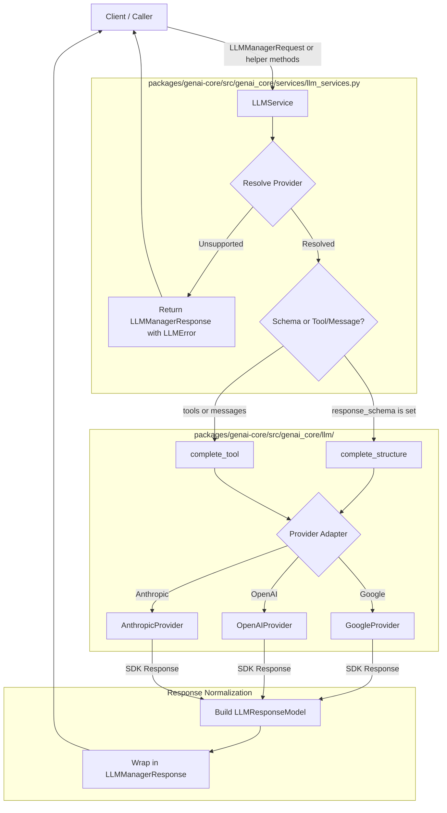

# Execution & Data Flow: `genai-core` Scope

This document details the actual verified execution flows, component interactions, and data normalization across `genai-core` (`packages/genai-core/`).

---

## 1. Request Lifecycle Overview

The diagram below illustrates how client calls enter `LLMService`, get dispatched to provider adapters conforming to `LLMProvider`, and return normalized responses:

---

## 2. Request Dispatch & Routing

### 2.1 Provider Resolution
- **File**: [`packages/genai-core/src/genai_core/services/llm_services.py`](file:///home/harshilk/genai-engineer-journey/packages/genai-core/src/genai_core/services/llm_services.py)
- **Function**: [`LLMService.complete`](file:///home/harshilk/genai-engineer-journey/packages/genai-core/src/genai_core/services/llm_services.py#L55-L121)
- **Execution Flow**:
  1. Receives an [`LLMManagerRequest`](file:///home/harshilk/genai-engineer-journey/packages/genai-core/src/genai_core/models/llm_model/llm_manager_request.py).
  2. Resolves provider name via precedence: `request.provider` -> `self.default_provider` -> `settings.default_llm_provider` -> fallback `"google"`.
  3. Checks `self.providers.get(provider_name)`.
  4. If provider is `None`: immediately returns `LLMManagerResponse(error=LLMError(provider=provider_name, code="unsupported_provider", message=...))`.

### 2.2 Operation Routing
- **If `request.response_schema is not None`**:
  - Extracts prompt: `request.prompt` or the content of the last message in `request.messages`.
  - Dispatches to `await provider.complete_structure(prompt=prompt, response_schema=request.response_schema)`.
- **If `request.response_schema is None`**:
  - Prepares messages: if `request.messages` is empty but `request.prompt` is present, builds `[ChatMessage(role="user", content=request.prompt)]`.
  - Dispatches to `await provider.complete_tool(messages=messages, tools=request.tools, tool_choice=request.tool_choice)`.

---

## 3. Provider-Specific Execution Flows

### 3.1 Google Gemini Flow (`GoogleProvider`)
- **File**: [`packages/genai-core/src/genai_core/llm/google_provider.py`](file:///home/harshilk/genai-engineer-journey/packages/genai-core/src/genai_core/llm/google_provider.py)

#### Structured Output (`complete_structure`)
1. Instantiates `types.GenerateContentConfig(temperature=self.temperature)`.
2. When `response_schema` is supplied, sets `config.response_mime_type = "application/json"` and `config.response_schema = response_schema`.
3. Invokes `await self.client.aio.models.generate_content(model=self.model, contents=prompt, config=config)`.
4. Parses JSON and validates against `response_schema.model_validate(parsed_json)`.
5. **Retry Mechanism**: If JSON parsing or Pydantic validation fails, retries up to `max_structured_error_retry` (from `Settings` in `genai_core.core`, default 2) times with feedback prompt containing error details. If all retries fail, raises `LLMValidationError`.
6. Calculates total latency and accumulated token counts from `response.usage_metadata`.
7. Returns [`LLMResponseModel`](file:///home/harshilk/genai-engineer-journey/packages/genai-core/src/genai_core/models/llm_model/llm_response_model.py) with `text`, `structured_response=validated_model_instance`, token usage, latency, and `model`.

#### Tool Calling (`complete_tool`)
1. Converts all `ToolSpec` objects into Gemini declarations: `types.FunctionDeclaration(**tool.to_google_function_declaration())`.
2. Extracts system instructions from messages with `role == "system"`.
3. Maps `tool_choice` to `types.ToolConfig(function_calling_config=...)` via `tool_choice.to_google()`.
4. Converts conversation messages to Gemini `types.Content`:
   - `role == "tool"`: Validates `message.tool_name` exists (raises `ValueError` if absent), decodes JSON payload into dict, wraps in `types.FunctionResponse`, and appends as `role="user"`.
   - `role == "assistant"`: Appends with `role="model"`.
   - `role == "user"`: Appends with `role="user"`.
5. Calls `await self.client.aio.models.generate_content`.
6. Inspects candidates and content parts for `part.function_call`.
7. Builds `ToolCall(id=f"google-{i}", name=function_call.name, arguments=dict(function_call.args))`.
8. Returns `LLMResponseModel(text=response.text if not calls else None, tool_calls=calls, ...)`.

#### Streaming (`stream`)
1. Extracts contents from messages (ignoring system role).
2. Calls `self.client.aio.models.generate_content_stream`.
3. Inspects whether return object is awaitable; awaits if necessary, then iterates asynchronously over stream chunks yielding `chunk.text`.

---

### 3.2 OpenAI Flow (`OpenAIProvider`)
- **File**: [`packages/genai-core/src/genai_core/llm/openai_provider.py`](file:///home/harshilk/genai-engineer-journey/packages/genai-core/src/genai_core/llm/openai_provider.py)

#### Structured Output (`complete_structure`)
1. Prepares `request_kwargs = {"model": self.model, "input": prompt}`.
2. If `response_schema` is present, adds `text={"format": {"type": "json_schema", "name": response_schema.__name__, "schema": response_schema.model_json_schema(), "strict": True}}`.
3. Calls `await self.client.responses.create(**request_kwargs)`.
4. Parses JSON and validates against `response_schema.model_validate(parsed_json)`.
5. **Retry Mechanism**: If JSON parsing or Pydantic validation fails, retries up to `max_structured_error_retry` (from `Settings` in `genai_core.core`, default 2) times with feedback prompt containing error details. If all retries fail, raises `LLMValidationError`.
6. Returns normalized `LLMResponseModel` with `structured_response=validated_model_instance`.

#### Tool Calling (`complete_tool`)
1. Converts tools into `FunctionToolParam` list via `tool.to_openai_tool()`.
2. Sets `tool_choice` using `tool_choice.to_openai()` (`"auto"`, `"required"`, or `{"type": "function", "name": ...}`).
3. Calls `await self.client.responses.create(model=self.model, input=[...], tools=..., tool_choice=...)`.
4. Iterates over `response.output`: identifies items with `type == "function_call"`, parses JSON arguments, and constructs `ToolCall(id=item.call_id, name=item.name, arguments=args)`.
5. Returns normalized `LLMResponseModel`.

#### Streaming (`stream`)
1. Formats input messages.
2. Context-manages `async with self.client.responses.stream(...) as stream:`.
3. Iterates over stream events; yields `event.delta` when event matches `ResponseTextDeltaEvent` or contains text delta.

---

### 3.3 Anthropic Claude Flow (`AnthropicProvider`)
- **File**: [`packages/genai-core/src/genai_core/llm/anthropic_provider.py`](file:///home/harshilk/genai-engineer-journey/packages/genai-core/src/genai_core/llm/anthropic_provider.py)

#### Structured Output (`complete_structure`)
1. Calls `await self.client.messages.create(model=self.model, max_tokens=self.max_tokens, messages=[{"role": "user", "content": prompt}])`.
2. Extracts combined text from blocks with `type == "text"`.
3. Parses JSON and validates against `response_schema.model_validate(parsed_json)`.
4. **Retry Mechanism**: If JSON parsing or Pydantic validation fails, retries up to `max_structured_error_retry` (from `Settings` in `genai_core.core`, default 2) times with feedback prompt containing error details. If all retries fail, raises `LLMValidationError`.
5. Returns normalized `LLMResponseModel` with `structured_response=validated_model_instance`.

#### Tool Calling (`complete_tool`)
1. Extracts system message string from messages.
2. Converts tools via `tool.to_anthropic_tool()` (`{"name": ..., "description": ..., "input_schema": ...}`).
3. Configures `tool_choice` via `tool_choice.to_anthropic()` (`{"type": "auto"}`, `{"type": "any"}`, or `{"type": "tool", "name": ...}`).
4. Calls `await self.client.messages.create(model=..., system=system, messages=request_messages, tools=..., tool_choice=...)`.
5. Iterates over `response.content`:
   - Extracts blocks with `type == "tool_use"` into `ToolCall(id=block.id, name=block.name, arguments=block.input)`.
   - Extracts blocks with `type == "text"` into `text`.
6. Returns normalized `LLMResponseModel`.

#### Streaming (`stream`)
1. Extracts user message content.
2. Context-manages `async with self.client.messages.stream(...) as stream:`.
3. Iterates asynchronously over `stream.text_stream` yielding chunks.

---

## 4. Concurrent Provider Query Flow (`complete_all`)

- **File**: [`packages/genai-core/src/genai_core/services/llm_services.py`](file:///home/harshilk/genai-engineer-journey/packages/genai-core/src/genai_core/services/llm_services.py#L148-L161)
- **Flow**:
  1. Invoked with `prompt` and optional `response_schema`.
  2. Creates concurrent asynchronous tasks for each provider registered in `self.providers`:
     `[provider.complete_structure(prompt=prompt, response_schema=response_schema) for provider in self.providers.values()]`.
  3. Executes tasks concurrently via `asyncio.gather(*tasks, return_exceptions=True)`.
  4. Returns a list containing `LLMResponseModel` instances or exceptions for failed providers without aborting successful ones.

---

## 5. Error Normalization Flow

- When any provider raises an unhandled exception inside `LLMService.complete`:
  1. Traps exception in `except Exception as error:`.
  2. Inspects `status_code` attribute if present on the exception.
  3. Inspects response body dict for nested `error.code` or `error.message`.
  4. Determines retryability: flags `retryable=True` if status code is in `{408, 429, 500, 502, 503, 504}`.
  5. Returns `LLMManagerResponse(error=LLMError(provider=provider_name, code=code, message=message, status_code=status_code, retryable=retryable))`.

---

## 6. Verification and Test Flow

The behavior above is verified through 39 automated unit tests in `packages/genai-core/tests/unit/`:
- **Protocol conformance**: [`test_protocol.py`](file:///home/harshilk/genai-engineer-journey/packages/genai-core/tests/unit/test_protocol.py) validates all adapters conform to `LLMProvider`.
- **Google adapter**: [`test_google_provider.py`](file:///home/harshilk/genai-engineer-journey/packages/genai-core/tests/unit/test_google_provider.py) validates schema outputs, tool calling, tool-name enforcement, and streaming.
- **OpenAI adapter**: [`test_openai_provider.py`](file:///home/harshilk/genai-engineer-journey/packages/genai-core/tests/unit/test_openai_provider.py) validates structured output formatting, function calls, and delta streaming.
- **Anthropic adapter**: [`test_anthropic_provider.py`](file:///home/harshilk/genai-engineer-journey/packages/genai-core/tests/unit/test_anthropic_provider.py) validates structured output JSON decoding, tool choice, and text streaming.
- **Service orchestration**: [`test_llm_service.py`](file:///home/harshilk/genai-engineer-journey/packages/genai-core/tests/unit/test_llm_service.py) validates dispatch, error shielding, `complete_all` concurrency, and stream delegation.
- **Tool definitions**: [`test_tool_spec.py`](file:///home/harshilk/genai-engineer-journey/packages/genai-core/tests/unit/test_tool_spec.py) validates schema generators and argument parsing.

---

## 7. Unimplemented / Reserved Areas

1. **Subpackages**: `agents/`, `embedding/`, `evaluation/`, `memory/`, `observability/`, `prompts/`, `retrieval/`, and `tools/` are currently empty directory placeholders. No execution flows exist for them yet.
2. **Integration Tests**: `tests/integration/` is currently empty; all automated verification is unit-level using injected mock clients.
3. **Anthropic Native Schema Enforcement**: Anthropic does not support native JSON grammar constraints outside tool calling; structured output decoding relies on parsing generated text into JSON.
