# Execution & Data Flow: `genai-core` Scope

This document details the actual verified execution flows, component interactions, and data normalization across the entire `genai-core` package (`packages/genai-core/`).

It is structured by service and capability, providing an evolving architecture map of how components connect.

---

## 1. Overall Package Architecture & Component Interconnection

`genai-core` provides reusable, provider-agnostic GenAI capabilities designed with clean layer separation, loose coupling, shared resilience, and cross-cutting observability:

```mermaid
flowchart TD
    Client[Consuming Application / Mini-Projects]

    subgraph PublicAPI ["Public API: genai_core"]
        direction TB
        LLM[LLMService]
        EMB[EmbeddingService]
        RET[RetrievalService]
        MEM[MemoryService]
        RESIL[Resilience: RateLimiter & RetryPolicy]
        OBS[Observability Engine]
        MODELS[Models: Request & Response Contracts]
        EXC[Exceptions: Typed Error Hierarchy]
        CORE[Core: Settings & Configuration]
    end

    Client -->|generate text / tool calls| LLM
    Client -->|vectorize text / documents| EMB
    Client -->|semantic search & index| RET
    Client -->|conversation & episodic memory| MEM
    Client -->|configure logging / request_id context| OBS
    Client -->|access config / typed models| MODELS

    subgraph ServiceLayer ["Service Orchestration Layer"]
        LLM --> LLMProviderResolve{"Resolve LLM Provider"}
        EMB --> EMBProviderResolve{"Resolve Embedding Provider"}
        RET --> RETStoreResolve{"VectorStoreAdapter"}
        RET --> RETEmbedQuery["EmbeddingService.embed_query()"]
        MEM --> MEMSubsystems["ShortTerm / LongTerm / Episodic Subsystems"]
        MEMSubsystems --> MEMStoreResolve{"MemoryStorageAdapter"}
        MEMSubsystems --> MEMEmbedQuery["EmbeddingService.embed_query()"]
    end

    subgraph ResilienceSubsystem ["Shared Resilience Infrastructure"]
        EMB --> RateLimiter[RateLimiter: RPM & TPM Token Bucket]
        EMB --> RetryPolicy[RetryPolicy: Exponential Backoff & Jitter]
        RET --> RetryPolicy
        RateLimiter -.->|reusable by| LLM
    end

    subgraph CrossCutting ["Cross-Cutting Observability & Safety"]
        OBS --> ContextManager[observability_context / request_id]
        OBS --> SafeLog[safe_log Fault Isolation]
        OBS --> Redaction[RedactingFilter Secret Scrubbing]
    end

    LLM -.->|emit lifecycle events| SafeLog
    EMB -.->|emit lifecycle events| SafeLog
    RET -.->|emit lifecycle events| SafeLog
    MEM -.->|emit lifecycle events| SafeLog
    ResilienceSubsystem -.->|emit throttled / retry / timeout events| SafeLog

    subgraph Adapters ["Integration & Storage Adapters"]
        LLMProviderResolve --> GoogleLLM[GoogleProvider]
        LLMProviderResolve --> OpenAILLM[OpenAIProvider]
        LLMProviderResolve --> AnthropicLLM[AnthropicProvider]

        EMBProviderResolve --> LocalEmb[LocalEmbeddingProvider]
        EMBProviderResolve --> OpenAIEmb[OpenAIEmbeddingProvider]
        EMBProviderResolve --> GoogleEmb[GoogleEmbeddingProvider]

        RETStoreResolve --> InMemoryStore[InMemoryVectorStore: Zero-dependency]
        RETStoreResolve --> PGVectorStore[PGVectorStoreAdapter: PostgreSQL]

        MEMStoreResolve --> InMemoryMemStore[InMemoryMemoryStore: Ephemeral / Test]
        MEMStoreResolve --> PGMemStore[PostgresMemoryStore: PostgreSQL + pgvector]
    end

    subgraph FutureServices ["Future Services (Planned)"]
        TOOL[ToolOrchestrator]
    end

    SafeLog --> Formatter[JsonFormatter / TextFormatter]
    Formatter --> Output[Caller-Defined File / Console]
```

### Component Roles & Responsibilities:
- **`genai_core.services`**: Unified entry points (`LLMService`, `EmbeddingService`, `RetrievalService`, `MemoryService`). Validate input, resolve providers/backends, coordinate internal batching, manage fault isolation, and emit observability events.
- **`genai_core.retrieval`**: Vector store abstractions, hybrid search, and re-ranking implementations:
  - `VectorStoreAdapter`: Runtime-checkable protocol defining `dimensions`, `search`, `search_keyword`, `upsert`, and `delete`.
  - `InMemoryVectorStore`: Zero-dependency in-memory reference store using exact cosine similarity, term-frequency keyword matching, metadata filtering, and score thresholding.
  - `PGVectorStoreAdapter`: Production PostgreSQL pgvector adapter using connection injection, parameterized `<=>` cosine distance, full-text search (`ts_rank_cd`), and JSONB containment filtering.
  - `CrossEncoderReranker`: Neural re-ranking adapter (`cross-encoder/ms-marco-MiniLM-L6-v2`) executing in worker threads via `asyncio.to_thread`.
- **`genai_core.memory`**: Multi-type memory subsystem with pluggable persistence:
  - `ShortTermMemory`: Conversational history with turn tracking, pinned agent instructions, token budget snapshot pruning via `TokenCounter`, and session inactivity TTL.
  - `LongTermMemory`: Durable user profile facts and preferences with vector embedding, conflict resolution (`supersedes_ids`), temporal expiration, hybrid cosine similarity + exponential recency decay ranking ($0.65 \times \text{sim} + 0.35 \times \text{recency} - 2.0 \times \text{is\_superseded}$), and automatic knowledge consolidation (`consolidate`).
  - `EpisodicMemory`: Historical action log with canonical JSON parameter fingerprinting (deterministic SHA-256), idempotency decision checking (`execute` vs `do_not_repeat`), and rolling retention window purging.
  - `InMemoryMemoryStore` & `PostgresMemoryStore`: Pluggable storage adapters conforming to `MemoryStorageAdapter`.
- **`genai_core.resilience`**: Shared asynchronous resilience infrastructure (`RateLimiter`, `AsyncTokenBucket`, `RetryPolicy`, `execute_with_retry`, `extract_retry_after`, `estimate_tokens`). Implements in-memory token bucket pacing for RPM/TPM and bounded retries with jitter and deadlines. Reused across embeddings, retrieval, and LLMs.
- **`genai_core.llm`**: Adapters conforming to `LLMProvider` protocol translating between normalized contracts and vendor SDKs (Google, OpenAI, Anthropic).
- **`genai_core.embedding`**: Adapters conforming to `EmbeddingProvider` protocol (`LocalEmbeddingProvider`, `OpenAIEmbeddingProvider`, `GoogleEmbeddingProvider`).
- **`genai_core.observability`**: Reusable logging with caller-isolated outputs, secret/key scrubbing, asynchronous request context propagation, and zero side effects by default.
- **`genai_core.models`**: Pydantic v2 schemas (`ChatMessage`, `LLMManagerRequest`, `LLMResponseModel`, `EmbeddingRequest`, `EmbeddingResponse`, `DocumentChunk`, `RetrievalQuery`, `RetrievalResult`, `RetrievalResponse`, `ConversationMessage`, `PinnedGoal`, `WorkingContext`, `LongTermMemoryRecord`, `MemoryCandidate`, `ActionEpisode`, `ConsolidationResult`, `ToolSpec`).
- **`genai_core.exceptions`**: Typed error hierarchies (`LLMError`, `EmbeddingError`, `EmbeddingDimensionError`, `EmbeddingTimeoutError`, `RetrievalError`, `VectorStoreError`, `IncompatibleEmbeddingError`, `UnsupportedSearchModeError`, `RetrievalTimeoutError`, `MemoryError`, `MemoryStorageError`, `MemoryNotFoundError`, `MemoryValidationError`, `MemoryExtractionError`).
- **`genai_core.core`**: Environment settings loaded via `pydantic-settings` with explicit precedence and fallback defaults.

---

## 2. LLMService Execution Flow

The diagram below illustrates how client calls enter `LLMService`, get dispatched to provider adapters conforming to `LLMProvider`, and return normalized responses:

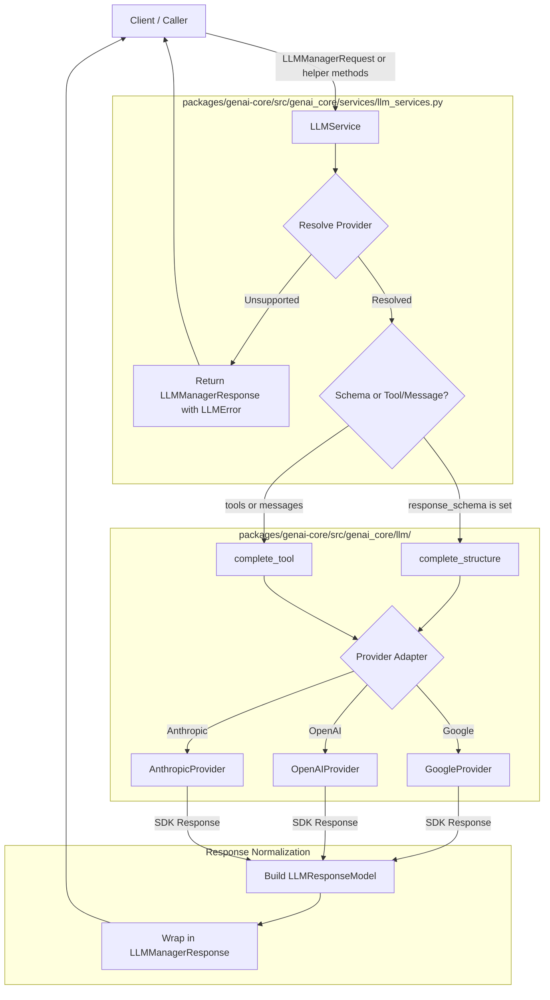

### 2.1 Request Dispatch & Routing
- **File**: [`packages/genai-core/src/genai_core/services/llm_services.py`](file:///home/harshilk/genai-engineer-journey/packages/genai-core/src/genai_core/services/llm_services.py)
- **Function**: [`LLMService.complete`](file:///home/harshilk/genai-engineer-journey/packages/genai-core/src/genai_core/services/llm_services.py#L55-L121)
- **Execution Flow**:
  1. Receives an [`LLMManagerRequest`](file:///home/harshilk/genai-engineer-journey/packages/genai-core/src/genai_core/models/llm_model/llm_manager_request.py).
  2. Resolves provider name via precedence: `request.provider` -> `self.default_provider` -> `settings.default_llm_provider` -> fallback `"google"`.
  3. Checks `self.providers.get(provider_name)`.
  4. If provider is `None`: immediately returns `LLMManagerResponse(error=LLMError(provider=provider_name, code="unsupported_provider", message=...))`.
  5. **Operation Routing**:
     - **If `request.response_schema is not None`**: extracts prompt and calls `await provider.complete_structure(prompt=prompt, response_schema=request.response_schema)`.
     - **If `request.response_schema is None`**: builds messages and calls `await provider.complete_tool(messages=messages, tools=request.tools, tool_choice=request.tool_choice)`.

### 2.2 Provider Adapters
- **Google Gemini (`GoogleProvider`)**: Uses `google-genai` SDK. Supports native JSON schema constraints, function calling declarations, and delta streaming.
- **OpenAI (`OpenAIProvider`)**: Uses `openai` SDK v1+. Supports strict structured schema responses (`text={"format": ...}`), tool schemas via `FunctionToolParam`, and event stream deltas.
- **Anthropic Claude (`AnthropicProvider`)**: Uses `anthropic` SDK. Extracts text blocks for JSON schema validation, maps tools into Anthropic tool specs, and streams text deltas.

### 2.3 Concurrent Provider Query Flow (`complete_all`)
- Takes `prompt` and optional `response_schema`.
- Spawns concurrent asynchronous tasks for each registered provider using `asyncio.gather(*tasks, return_exceptions=True)`.
- Returns a list containing `LLMResponseModel` instances or exceptions for failed providers without aborting successful ones.

### 2.4 Error Normalization Flow
- Provider exceptions are intercepted and inspected for HTTP status codes, error codes, and messages.
- Status codes in `{408, 429, 500, 502, 503, 504}` are flagged `retryable=True`.
- Returns `LLMManagerResponse(error=LLMError(...))` guaranteeing no unhandled exceptions leak to callers.

---

## 3. Observability Execution Flow

Observability is a cross-cutting subsystem in `packages/genai-core/src/genai_core/observability/`:

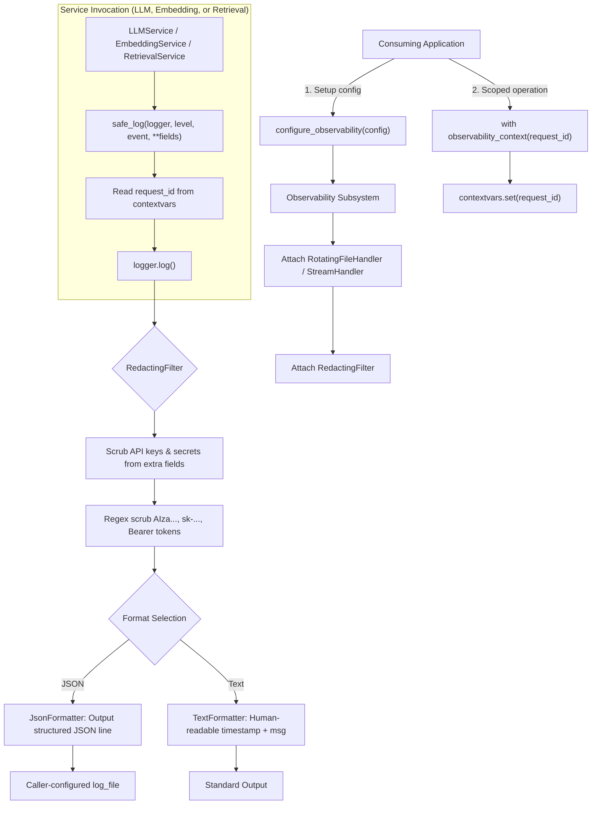

---

## 4. EmbeddingService Execution Flow

`EmbeddingService` provides standardized vector generation across local, OpenAI, and Google providers, with strict dimension validation, internal batching, token bucket rate limiting, and bounded retries:

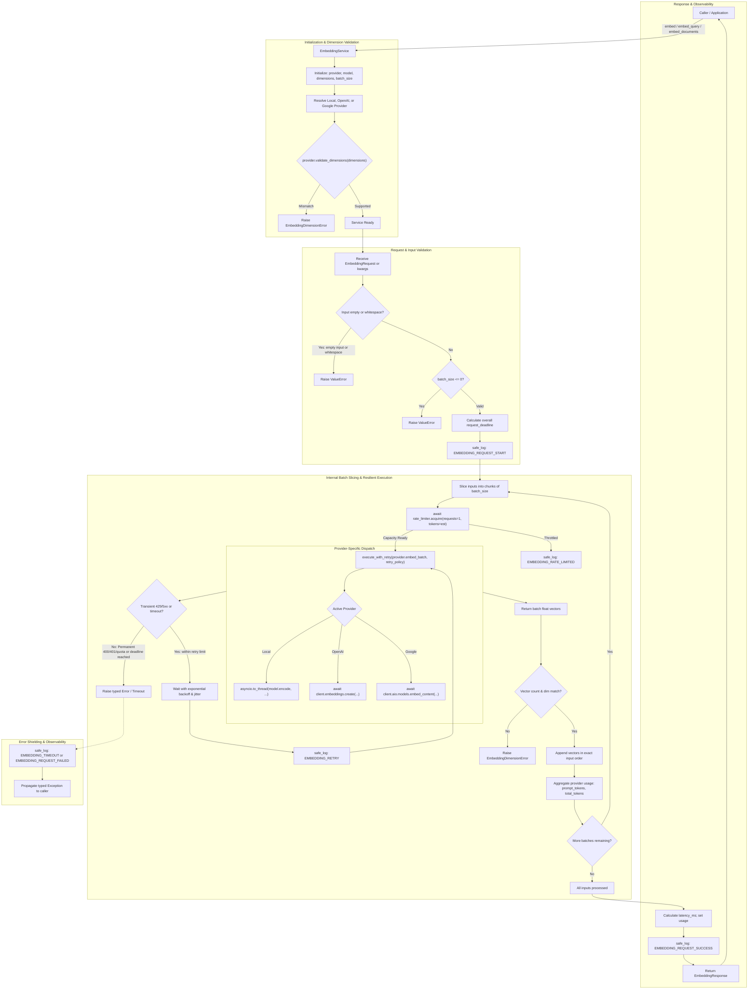

### 4.1 Service Initialization & Strict Dimension Validation
- **Location**: [`packages/genai-core/src/genai_core/services/embedding_service.py`](file:///home/harshilk/genai-engineer-journey/packages/genai-core/src/genai_core/services/embedding_service.py)
- **Execution Flow**:
  1. Resolves default configurations from `Settings` (`default_embedding_provider="local"`, `default_embedding_model="all-MiniLM-L6-v2"`, `default_embedding_dimensions=384`, `default_embedding_batch_size=32`).
  2. Resolves active provider: accepts registered provider dictionary, provider name string (`"local"`, `"openai"`, `"google"`), or direct `EmbeddingProvider` instance.
  3. **Strict Dimension Validation**: Calls `self.active_provider.validate_dimensions(self.dimensions)` at initialization.
     - For `LocalEmbeddingProvider`: `all-MiniLM-L6-v2` strictly rejects `dimensions=768` by raising `EmbeddingDimensionError(model='all-MiniLM-L6-v2', requested=768, supported=384)`.
     - For `OpenAIEmbeddingProvider`: `text-embedding-3-small` allows dimensions `<= 1536`, `text-embedding-3-large` allows `<= 3072`, while `text-embedding-ada-002` strictly requires `1536`.
     - For `GoogleEmbeddingProvider`: `text-embedding-005` native dimension is `768`, allowing output dimensionality `<= 768`. Prohibits retired `text-embedding-004`.
     - Invalid configurations fail fast before any inference or data processing occurs.

### 4.2 Request Preparation & Input Validation
- Accepts an [`EmbeddingRequest`](file:///home/harshilk/genai-engineer-journey/packages/genai-core/src/genai_core/models/embedding_model/embedding_request.py) object or keyword arguments (`input`, `batch_size`, `normalize_embeddings`).
- **Empty Input Checking**:
  - `input=[]`: raises `ValueError("Input cannot be empty.")`.
  - `input=""` or all-whitespace string: raises `ValueError("Input text cannot be empty or whitespace only.")`.
  - `input=["valid", "   "]`: raises `ValueError("Input text at index 1 cannot be empty or whitespace only.")`.
- **Batch Size Checking**:
  - `batch_size <= 0`: raises `ValueError("batch_size must be greater than 0.")`.
- **Bounded Request Deadline**: Computes overall request deadline `time.monotonic() + self.retry_policy.timeout_seconds` across the entire multi-batch request.
- Emits `EMBEDDING_REQUEST_START` via `safe_log` with provider, model, dimensions, total inputs, and batch counts.

### 4.3 Provider Adapters
1. **`LocalEmbeddingProvider`**:
   - Runs `sentence-transformers` via `asyncio.to_thread` for non-blocking execution.
   - Caches models using `@lru_cache(maxsize=4)`.
   - `sentence-transformers` is an optional extra (`genai-core[local]`).
2. **`OpenAIEmbeddingProvider`**:
   - Uses `AsyncOpenAI` SDK (`client.embeddings.create(input=texts, model=..., dimensions=...)`).
   - Sorts returned embeddings by item index to guarantee input order preservation regardless of API concurrency.
   - Stores exact token usage in `last_usage = {"prompt_tokens": ..., "total_tokens": ...}`.
3. **`GoogleEmbeddingProvider`**:
   - Uses current `google-genai` SDK with model `text-embedding-005`.
   - Configures `EmbedContentConfig(output_dimensionality=dimensions)` for variable dimensionality.
   - L2-normalizes vectors and wraps provider errors in `EmbeddingProviderError`.

---

## 5. Shared Resilience Execution Flow

Resilience logic is isolated in `packages/genai-core/src/genai_core/resilience/` as a shared capability reusable across services:

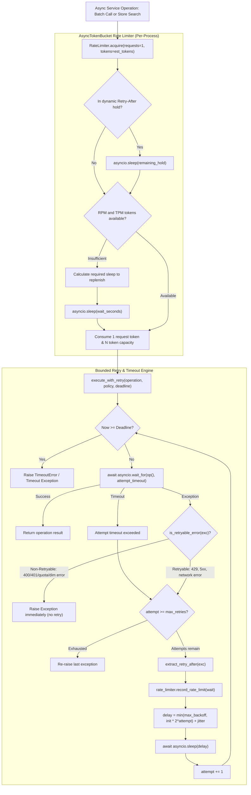

### 5.1 Per-Process Token Bucket Rate Limiting
- **Location**: [`packages/genai-core/src/genai_core/resilience/rate_limiter.py`](file:///home/harshilk/genai-engineer-journey/packages/genai-core/src/genai_core/resilience/rate_limiter.py)
- **Mechanics**:
  - Maintained as dual token buckets: Request Bucket (RPM) and Token Bucket (TPM).
  - Continuous fractional replenishment based on elapsed wall-clock time (`time.monotonic()`).
  - Thread/coroutine-safe asynchronous acquisition via `asyncio.Lock`.
  - Non-blocking waiting: coroutines sleep only for the exact duration required to replenish capacity, without blocking unrelated async tasks.
  - **Scope**: Documented as strictly **per-process in-memory**. Does not require Redis or external infrastructure in this phase.
  - **Internal Pacing Token Estimation**: Uses `estimate_tokens(texts)` heuristic (~4 characters per token) strictly for TPM pacing. These pacing estimates are internal and never leaked as actual usage in `EmbeddingResponse`.

### 5.2 Error Classification & Selective Retryability
- **Location**: [`packages/genai-core/src/genai_core/resilience/retry_policy.py`](file:///home/harshilk/genai-engineer-journey/packages/genai-core/src/genai_core/resilience/retry_policy.py)
- **Retryable Errors**:
  - Network timeouts, connection resets, transient DNS failures.
  - HTTP `408 Request Timeout`, `429 Too Many Requests`.
  - HTTP `500 Internal Server Error`, `502 Bad Gateway`, `503 Service Unavailable`, `504 Gateway Timeout`.
- **Non-Retryable Errors (Fail-Fast)**:
  - Input validation errors (`ValueError`, `TypeError`).
  - Strict dimension mismatches (`EmbeddingDimensionError`, `IncompatibleEmbeddingError`).
  - Unsupported search mode errors (`UnsupportedSearchModeError`).
  - Missing dependency errors (`MissingExtraDependencyError`).
  - HTTP 400 Bad Request, 401 Unauthorized, 403 Forbidden.
  - Quota exhaustion / billing failure (`insufficient_quota`, `billing_not_active`, `account_deactivated`).
- **`Retry-After` Header Parsing**: Parses integer seconds, floats, or RFC-2822 date strings from `Retry-After` HTTP headers. When received on a 429 response, informs the `RateLimiter` to pause subsequent dispatches dynamically.

---

## 6. RetrievalService, Hybrid Search & Re-ranking Flow

`RetrievalService` provides unified semantic (dense), full-text (sparse), and hybrid search, score fusion, optional cross-encoder re-ranking, and document indexing:

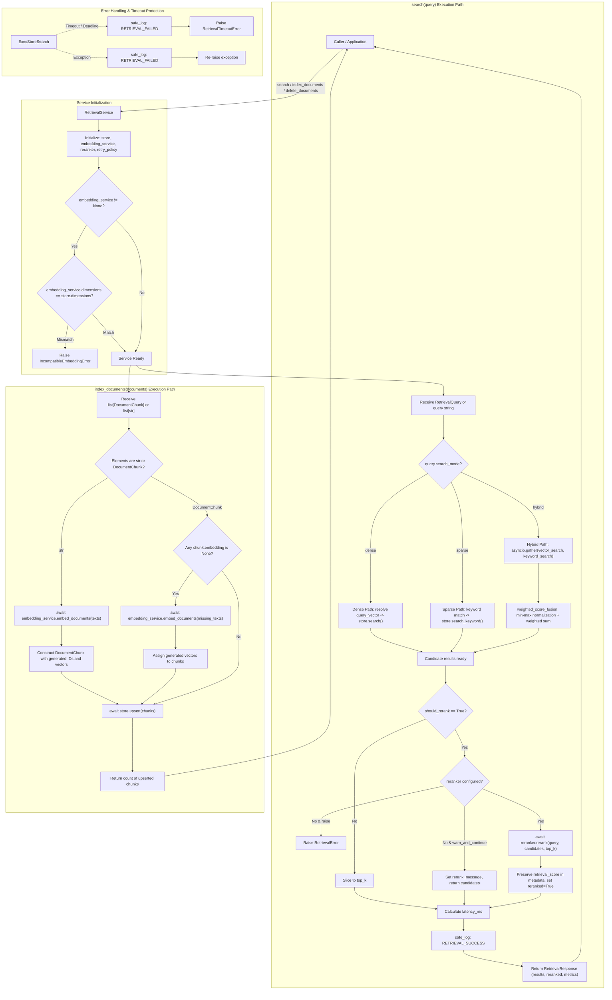

### 6.1 Query Validation and Extensibility Rules
- **Location**: [`packages/genai-core/src/genai_core/models/retrieval_model/retrieval_query.py`](file:///home/harshilk/genai-engineer-journey/packages/genai-core/src/genai_core/models/retrieval_model/retrieval_query.py)
- **Input Validation**:
  - `query` (text) or `query_vector` (float list) must be provided. If both are omitted, empty, or whitespace-only, raises `ValueError`.
  - `top_k` must be greater than 0 (`top_k <= 0` raises `ValueError`).
  - `score_threshold` if provided must be bounded between `0.0` and `1.0`.
- **Search Mode Policy**:
  - The request contract defines `search_mode: Literal["dense", "sparse", "hybrid"] = "dense"`.
  - Supports `"dense"` (dense vector search), `"sparse"` (full-text keyword search via PostgreSQL / in-memory), and `"hybrid"` (concurrent execution of dense and keyword search with min-max score normalization and weighted fusion).
  - Any unsupported search mode value strictly raises `UnsupportedSearchModeError(mode)`. The system never silently falls back.

### 6.2 Embedding Compatibility and Dimension Enforcement
- **Location**: [`packages/genai-core/src/genai_core/services/retrieval_service.py`](file:///home/harshilk/genai-engineer-journey/packages/genai-core/src/genai_core/services/retrieval_service.py)
- At service initialization, if an `EmbeddingService` is provided, `self.embedding_service.dimensions` is validated against `self.store.dimensions`. A mismatch immediately raises `IncompatibleEmbeddingError(requested, supported)`.
- When pre-computed `query_vector` is supplied in `RetrievalQuery`, `len(query_vector)` is validated against `self.store.dimensions`.

### 6.3 In-Memory Vector Store (`InMemoryVectorStore`)
- **Location**: [`packages/genai-core/src/genai_core/retrieval/in_memory_store.py`](file:///home/harshilk/genai-engineer-journey/packages/genai-core/src/genai_core/retrieval/in_memory_store.py)
- Implements [`VectorStoreAdapter`](file:///home/harshilk/genai-engineer-journey/packages/genai-core/src/genai_core/retrieval/protocol.py).
- Zero external dependencies: computes exact cosine similarity `dot(a, b) / (norm(a) * norm(b))`, clamped to `[-1.0, 1.0]`.
- Supports exact metadata key-value filtering, score threshold filtering, and descending rank assignment.
- Enables deterministic, fast, offline unit testing without requiring Docker or PostgreSQL.

### 6.4 PostgreSQL pgvector Store (`PGVectorStoreAdapter`)
- **Location**: [`packages/genai-core/src/genai_core/retrieval/pgvector_store.py`](file:///home/harshilk/genai-engineer-journey/packages/genai-core/src/genai_core/retrieval/pgvector_store.py)
- **Role**: Concrete database adapter implementing [`VectorStoreAdapter`](file:///home/harshilk/genai-engineer-journey/packages/genai-core/src/genai_core/retrieval/protocol.py) with PostgreSQL and `pgvector`.
- **Injected Connection Management**: Requires injected `connection`, `connection_pool` (e.g. `psycopg_pool.AsyncConnectionPool`), or `connection_factory`. Never creates ad-hoc unpooled TCP connections per operation.
- **SQL Safety**:
  - Whitelist regex validation (`^[a-zA-Z_][a-zA-Z0-9_]*$`) for all table and column names, preventing SQL injection via dynamic identifiers.
  - Strict parameterization using `%s` placeholders for all dynamic inputs (vectors, filters, thresholds, chunk IDs).
- **Cosine Similarity & Ranking**:
  - Uses pgvector cosine distance operator `<=>`: `1 - (embedding <=> %s) AS similarity_score`.
  - Orders by `embedding <=> %s ASC` (nearest neighbors first) with `LIMIT %s`.
- **Metadata Filtering**:
  - Utilizes PostgreSQL JSONB containment (`metadata @> %s::jsonb`) to support dictionary subset filtering.
  - Supports optional dedicated tenant column (`tenant_id_column`) for indexed tenant partition filtering (`WHERE tenant_id = %s`).
- **Upsert & Delete**:
  - Upsert: Parameterized batch `INSERT INTO ... ON CONFLICT ({conflict_target}) DO UPDATE SET ...` updating text, vector, and metadata.
  - Delete: Parameterized `DELETE FROM {table_name} WHERE {id_col} = ANY(%s)`.
- **Resilience**: Translates database errors into `VectorStoreError`. Flags transient network/operational errors (connection reset, timeout, broken pipe, deadlock) as `retryable=True` for automatic retry by `execute_with_retry`.
- **Optional Dependency**: Declared under `[project.optional-dependencies] postgres = ["psycopg[binary]>=3.1.0", "pgvector>=0.2.0"]`. Attempting to use the adapter without installed dependencies raises `MissingExtraDependencyError`.

### 6.5 Document Indexing and Provenance
- `index_documents` accepts raw text strings or structured `DocumentChunk` instances.
- If raw strings or chunks lacking vectors are provided, `RetrievalService` utilizes `self.embedding_service.embed_documents` to generate embeddings in batches before dispatching to `store.upsert()`.
- Search results preserve the original `metadata`, `source_id`, and `rank` in [`RetrievalResult`](file:///home/harshilk/genai-engineer-journey/packages/genai-core/src/genai_core/models/retrieval_model/retrieval_response.py), guaranteeing evidence traceability for downstream prompt generation and citations.

---

---

## 7. Memory Subsystem Architecture & Execution Flow

`MemoryService` provides a unified entry point orchestrating three distinct types of memory, with caller-selectable storage backends (`InMemoryMemoryStore` and `PostgresMemoryStore`):

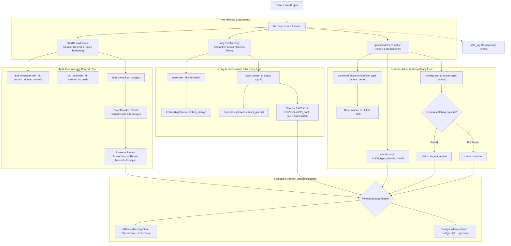

### 7.1 Short-Term Memory Flow
- **Session Scoping & User Isolation**: All message turns and pinned goals are indexed by composite key `(user_id, session_id)`.
- **Pinned Goals**: Critical instructions and system goals are pinned to persist unconditionally through context pruning.
- **Budgeting & Pruning**:
  1. Computes token cost of all pinned instructions first.
  2. Traverses conversation messages in reverse order (newest to oldest).
  3. Retains messages within the remaining budget (`max_tokens - pinned_cost`).
  4. Truncates older history and flags `WorkingContext.truncated = True`.
- **Inactivity Expiration**: Evaluates session idle time against `memory_working_ttl_hours`.

### 7.2 Long-Term Memory Flow
- **Validation**: Enforces strict `user_id` presence and content length bounds (1 to 4000 characters).
- **Vector Generation**: Vectorizes candidate content using `EmbeddingService.embed_query()`.
- **Supersession Resolution**:
  - When storing a record with `supersedes_ids`, targets are marked as `is_superseded = True`.
  - Searches dynamically penalize superseded records by `-2.0`, effectively filtering them unless `include_superseded=True`.
- **Hybrid Similarity & Recency Scoring**:
  $$\text{recency} = \exp\left(-\ln(2) \cdot \frac{\Delta t_{\text{days}}}{t_{1/2}}\right)$$
  $$\text{rank\_score} = 0.65 \cdot \text{similarity} + 0.35 \cdot \text{recency} - (2.0 \text{ if superseded else } 0)$$
- **Temporal Expiration**: Active searches filter out records where `expires_at <= now()`.

### 7.3 Episodic Memory Flow
- **Canonical Parameter Fingerprinting**:
  - Serializes `{action_type, target, parameters}` into canonical JSON with sorted keys, no whitespace separators (`","`, `":"`), and casefolded strings.
  - Produces a deterministic SHA-256 digest invariant to Python dict key insertion order.
- **Idempotency & Loop Prevention**:
  - `check(user_id, action_type, parameters)` verifies if an identical action was already executed.
  - Returns `ActionCheck(status="do_not_repeat")` with a reference to the previous episode, or `ActionCheck(status="execute")`.
- **Rolling Retention Purge**: Purges episodes older than `memory_episodic_retention_days` (default 14 days).

### 7.4 Pluggable Storage Adapters
- **`InMemoryMemoryStore`**: Thread-safe in-memory adapter implementing exact cosine similarity and mathematical recency decay. Ideal for fast unit testing and ephemeral agents.
- **`PostgresMemoryStore`**: PostgreSQL + pgvector adapter utilizing parameterized SQL queries, pgvector distance operator (`<=>`), Common Table Expression (CTE) recency scoring, and JSONB parameter indexing.

### 7.5 Automatic Knowledge Consolidation Flow
`MemoryService.consolidate()` extracts durable long-term memories from conversation turns using `LLMService`, filters out sensitive credentials, performs multi-level deduplication, and handles supersession:

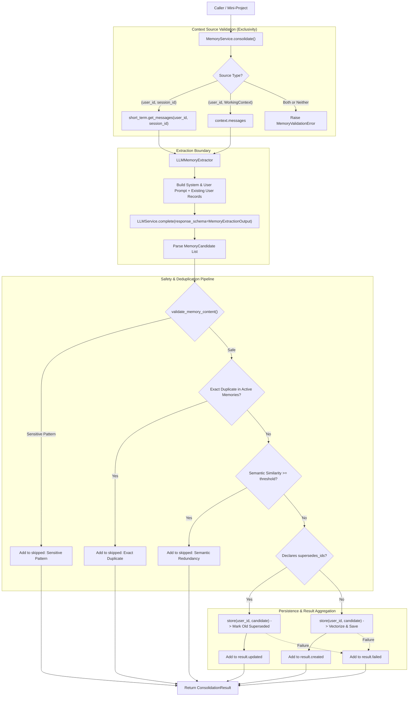

- **Dual Context Resolution**:
  - Exactly one context source is accepted per consolidation request.
  - Callers either provide `session_id` (retrieved from `short_term`) or directly inject `WorkingContext` (or `list[ConversationMessage]`).
- **Extraction Template & Customization**:
  - Established default prompt focuses on durable user facts, preferences, goals, and constraints while instructing the model to emit `supersedes_ids` for contradictions.
  - Callers can provide `custom_prompt_template` to specialize extraction behavior without altering package defaults.
- **Sensitive Information Safeguards**:
  - `validate_memory_content` scrubs credential, API key, access token, SSN, and credit card patterns before storage.
- **Deduplication Hierarchy**:
  1. *Exact Matching*: Matches normalized text and category against existing active records.
  2. *Semantic Cosine Similarity*: Computes vector similarity against existing active records in the same category; skips candidates exceeding `similarity_threshold` (default 0.95) if not declaring explicit supersession.
- **Supersession Invariants**:
  - Validates that declared `supersedes_ids` belong to the user's active memory pool.
  - Automatically updates superseded records to `is_superseded = True` during storage.
- **Observability**:
  - Emits `MEMORY_CONSOLIDATION_START` and `MEMORY_CONSOLIDATION_SUCCESS` / `MEMORY_CONSOLIDATION_FAILED` tracking extraction counts, persistence latency, and audit metadata.

---

## 8. Capability: Tool Subsystem & Orchestration Flow

The Tool subsystem (`genai_core.tools`) provides framework-independent tool definitions, cataloging, safe execution, authorization gating, and bounded multi-turn orchestration coordinated with `LLMService`.

### 8.1 Tool Subsystem Architecture Flow

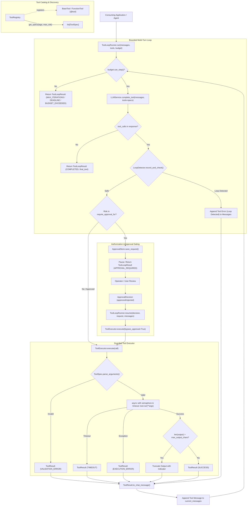

### 8.2 Bounded Multi-Turn Execution Sequence

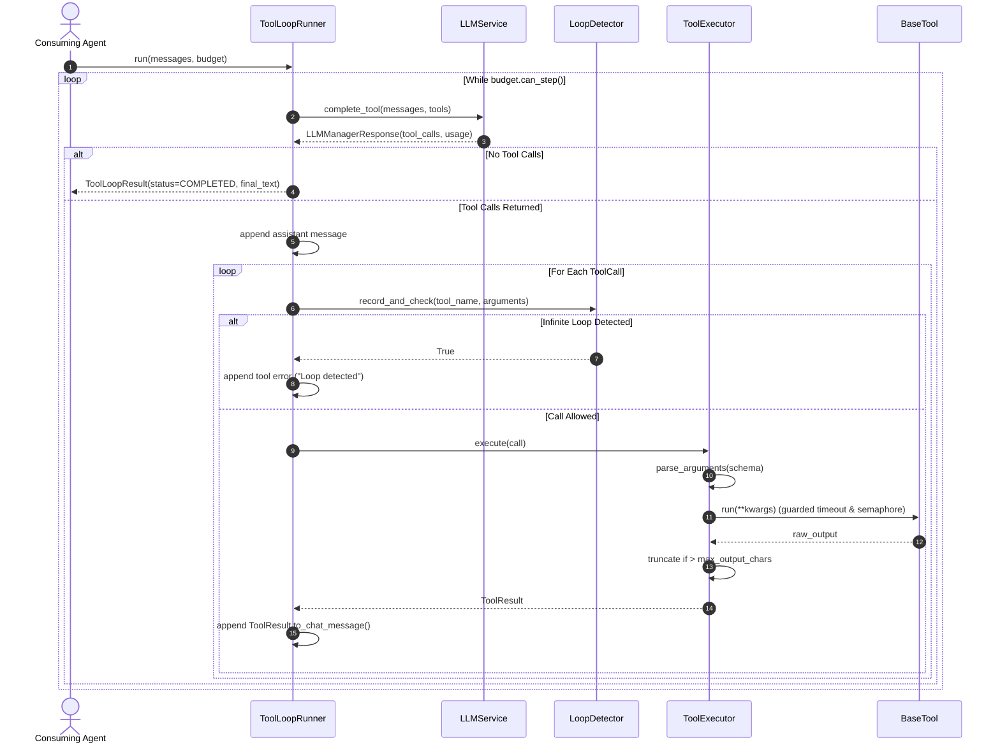

### 8.3 Human-in-the-Loop Approval & Pause/Resume Sequence

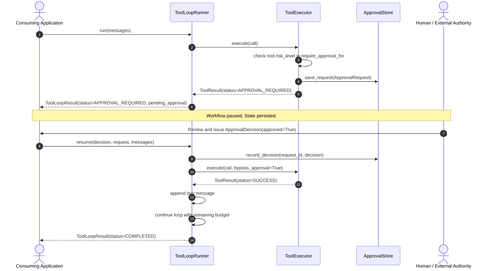

---

## 9. Verification and Test Flow

The behavior of `genai-core` is verified through automated unit tests organized by feature under `tests/unit/` and integration tests under `tests/integration/`:
- **Memory unit tests (`tests/unit/memory/`)**:
  - [`test_in_memory_store.py`](file:///home/harshilk/genai-engineer-journey/packages/genai-core/tests/unit/memory/test_in_memory_store.py) validates protocol conformance (`isinstance(store, MemoryStorageAdapter)`), cosine similarity, short-term message ordering and limits, pinned goals, budget pruning, strict user isolation across all three memory types, long-term recency decay and supersession ranking, episodic history lookup, and timestamped purging.
  - [`test_short_term.py`](file:///home/harshilk/genai-engineer-journey/packages/genai-core/tests/unit/memory/test_short_term.py) validates message additions, token count estimation, goal pinning and unpinning, snapshot budgeting, session TTL checking, and validation error handling.
  - [`test_long_term.py`](file:///home/harshilk/genai-engineer-journey/packages/genai-core/tests/unit/memory/test_long_term.py) validates memory candidate storage, content length bounds (1–4000 characters), semantic vector search, expiration filtering, viewing, and record deletion.
  - [`test_episodic.py`](file:///home/harshilk/genai-engineer-journey/packages/genai-core/tests/unit/memory/test_episodic.py) validates canonical parameter fingerprinting (key order invariance, whitespace/casefold invariance, JSON type safety), action execution recording, duplicate detection (`do_not_repeat`), and aged episode purging.
  - [`test_memory_service.py`](file:///home/harshilk/genai-engineer-journey/packages/genai-core/tests/unit/memory/test_memory_service.py) validates unified facade orchestration across short-term, long-term, and episodic subsystems.
- **Retrieval unit tests (`tests/unit/retrieval/`)**:
  - [`test_fusion.py`](file:///home/harshilk/genai-engineer-journey/packages/genai-core/tests/unit/retrieval/test_fusion.py) validates min-max normalization, weighted score blending, and threshold filtering.
  - [`test_reranker.py`](file:///home/harshilk/genai-engineer-journey/packages/genai-core/tests/unit/retrieval/test_reranker.py) validates cross-encoder re-ranking protocol conformance, prediction, and retrieval score auditability.
  - [`test_retrieval_service.py`](file:///home/harshilk/genai-engineer-journey/packages/genai-core/tests/unit/retrieval/test_retrieval_service.py) validates dense, sparse, and hybrid retrieval, re-ranking fallback, and indexing.
  - [`test_in_memory_store.py`](file:///home/harshilk/genai-engineer-journey/packages/genai-core/tests/unit/retrieval/test_in_memory_store.py) and [`test_pgvector_store.py`](file:///home/harshilk/genai-engineer-journey/packages/genai-core/tests/unit/retrieval/test_pgvector_store.py).
- **Embedding unit tests (`tests/unit/embedding/`)**:
  - [`test_embedding_service.py`](file:///home/harshilk/genai-engineer-journey/packages/genai-core/tests/unit/embedding/test_embedding_service.py), [`test_embedding_resilience.py`](file:///home/harshilk/genai-engineer-journey/packages/genai-core/tests/unit/embedding/test_embedding_resilience.py), [`test_openai_embedding_provider.py`](file:///home/harshilk/genai-engineer-journey/packages/genai-core/tests/unit/embedding/test_openai_embedding_provider.py), [`test_google_embedding_provider.py`](file:///home/harshilk/genai-engineer-journey/packages/genai-core/tests/unit/embedding/test_google_embedding_provider.py).
- **LLM unit tests (`tests/unit/llm/`)**:
  - [`test_llm_service.py`](file:///home/harshilk/genai-engineer-journey/packages/genai-core/tests/unit/llm/test_llm_service.py), [`test_protocol.py`](file:///home/harshilk/genai-engineer-journey/packages/genai-core/tests/unit/llm/test_protocol.py), [`test_tool_spec.py`](file:///home/harshilk/genai-engineer-journey/packages/genai-core/tests/unit/llm/test_tool_spec.py), [`test_google_provider.py`](file:///home/harshilk/genai-engineer-journey/packages/genai-core/tests/unit/llm/test_google_provider.py), [`test_openai_provider.py`](file:///home/harshilk/genai-engineer-journey/packages/genai-core/tests/unit/llm/test_openai_provider.py), [`test_anthropic_provider.py`](file:///home/harshilk/genai-engineer-journey/packages/genai-core/tests/unit/llm/test_anthropic_provider.py).
- **Observability unit tests (`tests/unit/observability/`)**:
  - [`test_observability.py`](file:///home/harshilk/genai-engineer-journey/packages/genai-core/tests/unit/observability/test_observability.py).
- **Tool unit tests (`tests/unit/tools/`)**:
  - [`test_tool_definition.py`](file:///home/harshilk/genai-engineer-journey/packages/genai-core/tests/unit/tools/test_tool_definition.py) validates `BaseTool` subclassing, `@tool` decorator on sync and async callables, custom metadata (risk level, tags, descriptions), automatic Pydantic schema generation from type hints, explicit `args_schema`, and parameterless tools.
  - [`test_tool_registry.py`](file:///home/harshilk/genai-engineer-journey/packages/genai-core/tests/unit/tools/test_tool_registry.py) validates thread-safe tool registration, raw callable wrapping, duplicate registration guards, lookup operations, unregistration, clearing, and spec filtering by tags, maximum risk levels, and exclusions.
  - [`test_tool_executor.py`](file:///home/harshilk/genai-engineer-journey/packages/genai-core/tests/unit/tools/test_tool_executor.py) validates successful sync and async execution, schema validation error normalization, unregistered tool handling, runtime exception isolation, timeout enforcement, output size truncation with warning indicators, batch execution via `execute_many`, and chat message formatting.
  - [`test_tool_guards.py`](file:///home/harshilk/genai-engineer-journey/packages/genai-core/tests/unit/tools/test_tool_guards.py) validates `LoopDetector` consecutive call counting, canonical SHA-256 argument normalization, key-order invariance, reset semantics, `InMemoryApprovalStore` CRUD operations, and risk-based authorization gating with bypass support.
  - [`test_tool_loop.py`](file:///home/harshilk/genai-engineer-journey/packages/genai-core/tests/unit/tools/test_tool_loop.py) validates multi-turn bounded execution, immediate text completion, multi-turn tool calling, step budget exhaustion, monotonic deadline timeouts, token budget enforcement, loop detection feedback, and human-in-the-loop approval pause and resume (both approved and rejected branches).
- **Live integration tests (`tests/integration/`)**:
  - **Tool integration tests (`tests/integration/tools/`)**: [`test_tool_subsystem_integration.py`](file:///home/harshilk/genai-engineer-journey/packages/genai-core/tests/integration/tools/test_tool_subsystem_integration.py) validates the complete end-to-end integration of registry, executor, approval store, budget tracking, and bounded loop execution through multiple tool turns, approval pausing on irreversible actions, and resuming upon authorization.
  - **Memory integration tests (`tests/integration/memory/`)**: [`test_postgres_memory_store_integration.py`](file:///home/harshilk/genai-engineer-journey/packages/genai-core/tests/integration/memory/test_postgres_memory_store_integration.py) validates live PostgreSQL persistence for short-term message ordering and budget pruning, long-term vector search with pgvector cosine distance, in-database recency scoring and supersession penalty, episodic action history lookup, and strict multi-user data isolation.
  - **LLM integration tests (`tests/integration/llm/`)**: [`test_anthropic_provider_integration.py`](file:///home/harshilk/genai-engineer-journey/packages/genai-core/tests/integration/llm/test_anthropic_provider_integration.py), [`test_google_provider_integration.py`](file:///home/harshilk/genai-engineer-journey/packages/genai-core/tests/integration/llm/test_google_provider_integration.py), [`test_openai_provider_integration.py`](file:///home/harshilk/genai-engineer-journey/packages/genai-core/tests/integration/llm/test_openai_provider_integration.py).
  - **Embedding integration tests (`tests/integration/embedding/`)**: [`test_local_embedding_integration.py`](file:///home/harshilk/genai-engineer-journey/packages/genai-core/tests/integration/embedding/test_local_embedding_integration.py), [`test_google_embedding_integration.py`](file:///home/harshilk/genai-engineer-journey/packages/genai-core/tests/integration/embedding/test_google_embedding_integration.py), [`test_openai_embedding_integration.py`](file:///home/harshilk/genai-engineer-journey/packages/genai-core/tests/integration/embedding/test_openai_embedding_integration.py).
  - **Retrieval integration tests (`tests/integration/retrieval/`)**: [`test_cross_encoder_reranker_integration.py`](file:///home/harshilk/genai-engineer-journey/packages/genai-core/tests/integration/retrieval/test_cross_encoder_reranker_integration.py), [`test_pgvector_store_integration.py`](file:///home/harshilk/genai-engineer-journey/packages/genai-core/tests/integration/retrieval/test_pgvector_store_integration.py), [`test_hybrid_retrieval_integration.py`](file:///home/harshilk/genai-engineer-journey/packages/genai-core/tests/integration/retrieval/test_hybrid_retrieval_integration.py).
  - **Observability integration tests (`tests/integration/observability/`)**: [`test_observability_integration.py`](file:///home/harshilk/genai-engineer-journey/packages/genai-core/tests/integration/observability/test_observability_integration.py).

